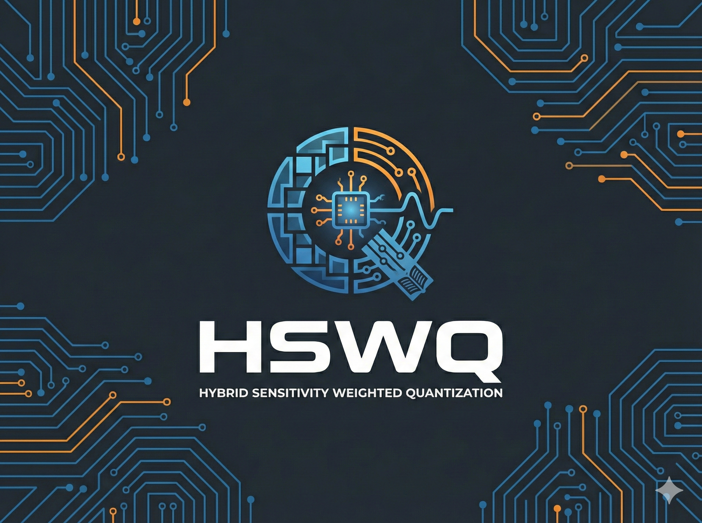

# Hybrid-Sensitivity-Weighted-Quantization (HSWQ)

<p align="center">
  
</p>

High-fidelity **ConvRot INT8** (SDXL, Krea2, Qwen Image Edit, SD1.5, MOSS-Image) and **ConvRot NVFP4** (Z Image Turbo) quantization for diffusion models. HSWQ uses **sensitivity** and **importance** analysis instead of naive uniform cast. SD1.5 ships as a **trajectory-impact hybrid**: a measured per-layer trajectory impact ranks every ConvRot-eligible layer, the top-K stay FP16, and the rest go ConvRot INT8 (UNet only - CLIP untouched, VAE dropped).

## Supported Models

- **ConvRot INT8 (SDXL, reverse hybrid):** FP16 checkpoint as the only input; a per-layer **trajectory-impact** measurement (`sdxl/diag_impact_sdxl.py`) ranks every candidate layer, then the **K lowest-impact layers** are packed as **FULL ConvRot INT8** while **every other layer stays FP16** (`sdxl/gen_reverse_int8_sdxl.py`). The ranking is measured on the actual sampling trajectory, so it captures the nonlinear error amplification that static weight-space saliency cannot represent. Guide: [How to quantize SDXL](md/How%20to%20quantize%20SDXL.md). Technical details: [Diag → Reverse Hybrid Quantization (SDXL, v1.1) — Technical Guide](md/Diag_Reverse_SDXL_v1.1_Technical_Guide.md).
- **ConvRot INT8 (SD1.5, trajectory-impact hybrid):** A measured per-layer **trajectory impact** (`sd1.5/diagimpact_sd15.py`) ranks every ConvRot-eligible layer: hold the rest pristine, replace ONE layer by its ConvRot INT8 reconstruction in the original frame, run the same 25-step trajectory, record `rel_mse` against the pristine run. The **top-K** stay FP16 and the rest go ConvRot INT8 (`sd1.5/quantize_sd1.5_hswq_v1.1.py`, with optional INT8-only bias correction). **CLIP is not quantized** and the **VAE is dropped**. **K is not a method constant**: it is chosen per checkpoint by sweeping the protected count and taking the point where the mean stops paying for the extra bytes. Both ends of that curve fail - a smaller set scores the same as native (the protection buys nothing) and a larger one scores *lower* while costing more, because a protected layer keeps its FP16 weights but loses the INT8 bias correction that cancels its systematic error. The retired **HSWQ V1.0** selector (`archives/quantize_sd1.5_hswq_v1.0.py`) ranked protection from static weight-space statistics and its protection set scored the same as native - the defect was the criterion, not the quantizer. Guide: [How to quantize SD1.5](md/How%20to%20quantize%20SD1.5.md). Technical details: [Diag Impact → Forward Top-K Hybrid Quantization (SD1.5, v1.1) — Technical Guide](md/Diag_Impact_SD1.5_v1.1_Technical_Guide.md).
- **ConvRot INT8 (Krea2):** Full HSWQ pipeline with structure blacklist protection (`first.`, `last.`, `mod.`, `norm`, `projector`, `txtfusion`, etc.) and data-driven 4-axis composite ranking (`Krea2/hswq_convrot_int8_krea2_v1.5.py`). For checkpoints where native ConvRot INT8 already reaches mean latent trajectory cosine $\ge 0.98$, native ConvRot INT8 is directly recommended. Guide: [How to quantize Krea2 ConvRot INT8](md/How%20to%20quantize%20Krea2.md).
- **Krea2 Hybrid ConvRot NVFP4:** **Development cancelled.** 4-bit precision (NVFP4) cannot maintain structural fidelity on Krea2 SingleStreamDiT; even with HSWQ sensitivity protection, final latent trajectory cosine fails to reach 0.90 (severe trajectory drift and collapse). Krea2 is supported strictly in **ConvRot INT8** only.
- **Z Image INT8 (HSWQ):** **Development and public release ended.** For Z Image, **native ConvRot INT8** already reaches roughly **SSIM > 0.99** in general, so a separate HSWQ Z Image 8-bit line is no longer developed or published. Use native ConvRot INT8 for Z Image 8-bit; HSWQ INT8 work continues for **SDXL**. Guide: [How to quantize Z Image](md/How%20to%20quantize%20Z%20Image.md).
- **Z Image Hybrid ConvRot NVFP4:** Built from a complete **native ConvRot INT8** UNet via the **reverse method** - layers are converted to NVFP4 in ascending order of per-layer impact (lowest-impact first). Unlike the conventional "protect top-important layers" approach, this stays in the low-error regime where single-layer ranking is valid. The number of NVFP4 layers varies per model (search `K`). Calibrated with `input_scale = amax / 2688` in **TC (W4A4)** mode. Scripts: `Z_Image/diag_impact.py`, `Z_Image/gen_reverse_nvfp4.py`, `Z_Image/calib_input_scale_nvfp4.py`, `benchmark/zi_convrot_nvfp4_traj_compare.py`. Guide: [How to quantize Z Image - Hybrid NVFP4](md/How%20to%20quantize%20Z%20Image%20-%20Hybrid%20NVFP4.md). Technical details: [Reverse-Method Hybrid ConvRot NVFP4 (Z Image) — Technical Guide](md/ZImage_Hybrid_ConvRot_NVFP4_Technical_Guide.md).
- **ConvRot INT8 (Qwen Image Edit):** FULL ConvRot INT8 via `Qwen Image/native_convert_int8_convrot_qwen.py` (FULL ConvRot ON by default, `--per_channel_int8` insurance for non-ConvRot packs, Card 1 bias correction opt-in) or the **`Native ConvRot INT8 Quantize`** ComfyUI node (`model_type = "Qwen Image Edit"`); post-convert benchmark is latent-space trajectory divergence (per-step cosine + bifurcation detection). Guide: [How to quantize Qwen Image Edit](md/How%20to%20quantize%20Qwen%20Image%20Edit.md).
- **Flux1 Hybrid ConvRot W4A8:** Built from a complete **native ConvRot INT8** pack via the **reverse method** - the lowest-impact layers move first into ConvRot W4A8, and the remaining converted layers stay ConvRot INT8, so one file carries both formats. The W4A8 layer is `asym_w4a8_int8`: 4-bit codes with a per-group (16) scale, a per-out-channel scale and a 16-entry codebook, ConvRot group size 256. Boundary layers (`img_in`, `txt_in`, `vector_in`, `time_in`, `guidance_in`, `final_layer`, `*_mod`, `modulation`, `norm`) are never re-encoded to 4 bits: they stay ConvRot INT8 in the hybrid, at the width the FLUX detector reads (`img_in`, `txt_in`, `vector_in.in_layer` would otherwise be halved by the nibble packing). `K` is not a method constant - it is chosen per checkpoint by searching the curve. ComfyUI core reads the format, so the pack loads in **Load Diffusion Model** / **UNetLoader**; **LoRA** on a 4-bit pack needs the HSWQ loader, because 16 code levels round a LoRA delta away and the loader adds it as a factorised residual after the GEMM. Scripts: `Flux1/diag_impact.py`, `Flux1/gen_reverse_w4a8.py`, `benchmark/flux1_convrot_w4a8_traj_compare.py`. Guide: [How to quantize Flux1 - Hybrid ConvRot W4A8](md/How%20to%20quantize%20Flux1%20-%20Hybrid%20ConvRot%20W4A8.md). Technical details: [Flux1 Hybrid ConvRot W4A8 — Technical Guide](md/Flux1_Hybrid_ConvRot_W4A8_Technical_Guide.md).
- **ConvRot INT8 (MOSS-Image):** FULL ConvRot INT8 via `moss/native_convert_int8_moss.py`; model detection is the MOSS-Image signature (`shared_block_modulation.weight` + `layers.0.proj.ffn_up_gate.weight`, fatal on failure), no structure blacklist, Card 1 bias correction opt-in. Guide: [How to quantize MOSS-Image](md/How%20to%20quantize%20MOSS-Image.md).
- **ConvRot INT8 (Text Encoder / ControlNet / Model Patch, individually built):** A separate **per-model track** for the families where the universal engine does not apply - each standard has one weight layout, so there is nothing to re-measure per checkpoint. The protection set comes from a measured **aggregate contribution** (per-block, float64), the threshold from the size/quality balance, and the kept tensors are stored FP16. Published as finished packs on Hugging Face (see below). Guide: [How to quantize Text Encoder, ControlNet and SAM 3 / 3.1](md/How%20to%20quantize%20Text%20Encoder%20and%20ControlNet.md).

**Technical details - active**

- **diag → forward top-K hybrid (SD1.5, v1.1):** [md/Diag_Impact_SD1.5_v1.1_Technical_Guide.md](md/Diag_Impact_SD1.5_v1.1_Technical_Guide.md) - the SD1.5 per-layer trajectory impact measured on terminal latent divergence ($x_T$ at step 25) without step-averaging, forward top-K FP16 protection, parameter byte-cost weighting, systematic INT8 bias correction, untouched CLIP pass-through, and embedded VAE removal; validated by the deterministic 25-seed trajectory gate.
- **diag → reverse hybrid (SDXL, v1.1):** [md/Diag_Reverse_SDXL_v1.1_Technical_Guide.md](md/Diag_Reverse_SDXL_v1.1_Technical_Guide.md) - the SDXL V3.1 selector (DualMonitor + V4 weighted-histogram MSE + full SVD, fixed 300 MiB FP16 protection) extended with the reverse step: per-layer ConvRot INT8 impact is measured on the production sampler, the K lowest-impact layers of the remaining pool are converted while every other layer (the protected set included) stays FP16; validated by the deterministic 25-seed latent-trajectory gate.
- **V5 histogram cosine:** [md/HSWQ_V5_Hybrid_SVD_RMS_Cosine_Technical_Guide.md](md/HSWQ_V5_Hybrid_SVD_RMS_Cosine_Technical_Guide.md) - Stage-3 amax search with the same SVD×RMS hybrid importance as V4, but **cosine similarity loss** on the importance-weighted magnitude histogram (not weighted MSE); includes a full MSE↔cosine mathematical comparison for quantization fidelity.

**Technical details - development ended (retained as technical assets)**

- **FP8:** [md/HSWQ_ Hybrid Sensitivity Weighted Quantization.md](md/HSWQ_%20Hybrid%20Sensitivity%20Weighted%20Quantization.md) - **FP8 development has ended**; this document is retained as a technical asset.
- **INT8 FP16-protect / pack overview:** [md/HSWQ_INT8_SDXL_Technical_Guide.md](md/HSWQ_INT8_SDXL_Technical_Guide.md) - **development ended**; this document is retained as a technical asset (static FP16-protect / pack path).

**ComfyUI Loader:** All HSWQ packs load with the custom node [ComfyUI-HSWQ-Loader-and-Tools](https://github.com/ussoewwin/ComfyUI-HSWQ-Loader-and-Tools). Note: **model patches** (the Qwen-Image DiffSynth suite, the Z-Image Fun ControlNets) go in `models/model_patches/` and load with the **HSWQ Model Patch Loader** - the ComfyUI `ModelPatchLoader` cannot read the INT8 layout. ControlNets go in `models/controlnet/`.

**VAE:** the SDXL and SD1.5 ConvRot INT8 packs do not embed a VAE. The checkpoint-embedded VAE (`first_stage_model.*`) is removed at conversion, so decode with a separate VAE. The SD1.5 CLIP is copied through unchanged - same keys, same dtypes, no quantization artifacts.

**Quantized packs (Hugging Face):**
  - [ControlNet-models-ConvRot-INT8](https://huggingface.co/ussoewwin/ControlNet-models-ConvRot-INT8) - ConvRot INT8 ControlNets and model patches: Illustrious-XL (anytest A/B), SDXL 1.0 (union-pro-max), FLUX.1-dev (Union Pro 2.0), Qwen-Image-2512 (Fun Union 2602), Qwen-Image (Inpainting), and the Qwen-Image DiffSynth canny / depth / inpaint suite. Each pack lists its exact size, SHA256, the required ComfyUI directory and the measured gate.
  - [Clip-files-HSWQ-ConvRot-INT8](https://huggingface.co/ussoewwin/Clip-files-HSWQ-ConvRot-INT8) - ConvRot INT8 text-encoder packs (CLIP-L, CLIP-SAE ViT-L/14, Long-ViT-L, ViT-L-BEST, CLIP-ViT-bigG, CLIP-ViT-H, Flan-T5-XXL, Josiefied-Qwen3-0.6B).
  - [qwen3_4b_8b_abliterated_fp16_convrot_int8](https://huggingface.co/ussoewwin/qwen3_4b_8b_abliterated_fp16_convrot_int8) - Qwen3-4B, Qwen3-8B, Qwen3-VL-4B-Thinking.
  - [SAM3.1-HSWQ-ConvRot-INT8](https://huggingface.co/ussoewwin/SAM3.1-HSWQ-ConvRot-INT8) - SAM 3.1 Multiplex.

<p align="center">
  
</p>

---

## Installation & Setup

```bash
# 1. Install PyTorch (CUDA)
pip install torch torchvision --index-url https://download.pytorch.org/whl/cu130

# 2. Install dependencies & quantization backend
pip install -r requirements.txt
pip install -U comfy_kitchen
pip install diffusers accelerate scikit-image
```

---

## How to quantize

> **ComfyUI Node Integration:** Progressive support for direct in-graph quantization inside ComfyUI via custom nodes (`comfyui_nodes/`) is currently underway. Support is available for **HSWQ Quantize ConvRot INT8** (`HSWQ Quantize ConvRot INT8`), **native ConvRot INT8** (`Native ConvRot INT8 Quantize`, `model_type`: Z Image / Qwen Image Edit / Krea2 / SDXL / SD1.5), and additional model architectures / quantization formats will be rolled out sequentially.

- **SDXL (ConvRot INT8, reverse hybrid):** [How to quantize SDXL](md/How%20to%20quantize%20SDXL.md)
- **SD1.5 (ConvRot INT8, trajectory-impact hybrid):** [How to quantize SD1.5](md/How%20to%20quantize%20SD1.5.md) - the guide also records why the retired V1.0 selector failed, the trajectory-vs-single-forward ranking difference (38 of the top 80 layers disagree), and the loader trap in three parts. Full in-workflow ComfyUI node support is available via `HSWQ Diag Impact (ConvRot INT8)` + `HSWQ Load Diag Impact Json` + `HSWQ Quantize ConvRot INT8`.
- **Krea2 (ConvRot INT8):** [How to quantize Krea2 ConvRot INT8](md/How%20to%20quantize%20Krea2.md) - CLI (`Krea2/hswq_convrot_int8_krea2_v1.5.py`) and ComfyUI custom node (`Native ConvRot INT8 Quantize`, `model_type = "Krea2"`).
- **Z Image (native ConvRot INT8):** [How to quantize Z Image](md/How%20to%20quantize%20Z%20Image.md) - CLI and ComfyUI custom node (`Native ConvRot INT8 Quantize`) quantization guide for the **general** ConvRot INT8 quantization method.
- **Z Image (Hybrid NVFP4, reverse method):** [How to quantize Z Image - Hybrid NVFP4](md/How%20to%20quantize%20Z%20Image%20-%20Hybrid%20NVFP4.md) - build a hybrid NVFP4 model from native ConvRot INT8 by converting the lowest-impact layers first (reverse method), calibrate `input_scale` for Tensor-Core W4A4.
- **Qwen Image Edit (native ConvRot INT8):** [How to quantize Qwen Image Edit](md/How%20to%20quantize%20Qwen%20Image%20Edit.md) - CLI (`Qwen Image/native_convert_int8_convrot_qwen.py`) and ComfyUI custom node (`Native ConvRot INT8 Quantize`, `model_type = "Qwen Image Edit"`).
- **Flux1 (native ConvRot INT8 / Hybrid ConvRot W4A8):** [How to quantize Flux1 - Hybrid ConvRot W4A8](md/How%20to%20quantize%20Flux1%20-%20Hybrid%20ConvRot%20W4A8.md) - Stage 1 builds the native ConvRot INT8 pack (`Flux1/native_convert_int8_convrot_flux.py`), Stage 2 turns it into the hybrid W4A8 pack (`Flux1/gen_reverse_w4a8.py`) with the reverse method and validates both with the deterministic 25-seed trajectory comparison.
- **MOSS-Image (native ConvRot INT8):** [How to quantize MOSS-Image](md/How%20to%20quantize%20MOSS-Image.md) - CLI (`moss/native_convert_int8_moss.py`); ComfyUI core reads the pack, so a dedicated HSWQ loader is not required.
- **Text Encoder / ControlNet / Model Patch (individually built, per-model track):** [How to quantize Text Encoder, ControlNet and SAM 3 / 3.1](md/How%20to%20quantize%20Text%20Encoder%20and%20ControlNet.md) - the **per-model track**, outside the HSWQ universal engine: each model's protection set comes from a measured aggregate contribution (Rules 1-8), verified through the loader the runtime uses on a fixed 256-item set. Carries the finished text-encoder, ControlNet and model-patch packs with their measured gates, and the finished-pack inventory (family / runtime object / directory / SHA256).
- **ControlNet & SAM 3 / 3.1 (native ConvRot INT8):** [How to quantize Text Encoder, ControlNet and SAM 3 / 3.1](md/How%20to%20quantize%20Text%20Encoder%20and%20ControlNet.md) - ComfyUI custom node (`TE / ControlNet ConvRot INT8 Quantize`, `HSWQ SAM3 Loader`) in-graph quantization guide for ControlNet / ControlNet Union / Model Patch models and Segment Anything foundation models (SAM 3 / SAM 3.1 Multiplex).

---

## Architecture

1. **Dual Monitor System** - During calibration, two metrics are collected:
   - **Sensitivity** (output variance): layers that hurt image quality most if corrupted → kept in FP16 when selected by HSWQ. The **ConvRot INT8 (SDXL) reverse hybrid** does not use this static path: its FP16 set is the complement of the K lowest-impact layers measured directly on the sampling trajectory.
   - **Importance:** V1 uses per-channel input mean-abs; V4 uses per-element SVD leverage × RMS magnitude hybrid → weights of the weighted histogram.
   **Technical details:** [Dual Monitor System - Technical Guide](md/Dual_Monitor_System_Technical_Guide.md).

2. **Rigorous grid / pack simulation**
   - **ConvRot INT8 (SDXL reverse hybrid):** each candidate layer's ConvRot INT8 reconstruction is injected on the FP16 baseline and propagated through the production sampler; the resulting trajectory drift ranks the layers. The K lowest-impact layers are packed (`rotate → per-channel INT8`); the rest stay FP16. Technical details: [Diag → Reverse Hybrid Quantization (SDXL, v1.1) — Technical Guide](md/Diag_Reverse_SDXL_v1.1_Technical_Guide.md).
   - **ConvRot INT8 (SD1.5 trajectory-impact hybrid):** each candidate layer's ConvRot INT8 reconstruction in the original frame is injected on the FP16 baseline; terminal latent divergence $x_T$ at step 25 ranks the layers. The top-K highest-impact layers stay FP16; the rest convert to ConvRot INT8 with systematic bias correction. Technical details: [Diag Impact → Forward Top-K Hybrid Quantization (SD1.5, v1.1) — Technical Guide](md/Diag_Impact_SD1.5_v1.1_Technical_Guide.md).

3. **Weighted Histogram Optimization** - Finds parameters that minimize quantization error using an importance-weighted histogram (not a plain frequency histogram).
   - **V1 / Fast:** per-channel importance (activation mean-abs) drives the histogram. **Technical details:** [Weighted Histogram MSE - Technical Guide](md/Weighted_Histogram_MSE_Technical_Guide.md).
   - **V4 (SVD × RMS hybrid, MSE):** per-element importance blends **SVD structural leverage** \(L(i,j)=(U_i\cdot\sigma)^2\cdot(V_j)^2\) with **RMS magnitude**; \(\alpha\) tilts toward SVD on heavy-tailed layers (retained as technical asset). **Technical details:** [HSWQ V4 SVD-RMS - Technical Guide](md/HSWQ_V4_Hybrid_SVD_RMS_Technical_Guide.md).
   - **V5 (SVD × RMS hybrid, cosine):** same hybrid importance family as V4; Stage-3 objective is **importance-weighted cosine loss** \(L=1-\langle x,q\rangle_H/(\|x\|_H\|q\|_H)\) against the physical FP8 E4M3 quantize-dequantize map (scale-invariant angular fidelity; reduces absolute-tail blackmail of \(\Delta^*\)). Source: `histogram/weighted_histogram_cosine_v5.py`. **Technical details:** [HSWQ V5 SVD-RMS Cosine - Technical Guide](md/HSWQ_V5_Hybrid_SVD_RMS_Cosine_Technical_Guide.md).
4. **Trajectory-Sensitivity Impact Ranking** - Ranks each layer by the divergence its
   quantization error actually causes after propagating through the full model and sampler
   (dynamical importance, replacing static weight-space saliency).
   - **Reverse method (SDXL ConvRot INT8):** the FP16 checkpoint is the only input; each candidate
     layer's ConvRot INT8 error is injected one at a time and the production sampler is run, so the
     ranking follows the real sampling trajectory. The K lowest-impact layers are packed as ConvRot
     INT8 and the rest stay FP16.
   - **Forward method (SD1.5 ConvRot INT8):** the FP16 checkpoint is the only input; each candidate layer's ConvRot INT8 reconstruction in the original frame is injected one at a time and evaluated on terminal latent divergence ($x_T$ at step 25) without step-averaging (which dilutes critical decoder skip errors). The top-K highest-impact layers stay in FP16, and the remaining layers convert to ConvRot INT8 with systematic bias correction.
   - **Reverse method (Z Image Hybrid NVFP4):** start from the complete native ConvRot INT8 UNet
     (error ≈ 0) and convert layers to NVFP4 in ascending impact order; single-layer ranking stays
     valid in the low-error additivity regime.
   - **Universal theory:** error interaction (Taylor cross terms, error cancellation), nonlinear
     amplification (Lyapunov-style growth), marginal effects, and Shapley-style attribution -
     why per-layer static measures (histogram MSE / cosine / SVD) cannot predict joint quantization
     error; applies to any iterative sampling system, not a specific model. Sources:
     `sdxl/diag_impact_sdxl.py` (SDXL), `sd1.5/diagimpact_sd15.py` (SD1.5), `Z_Image/diag_impact.py` (Z Image). **Technical details:**
     [Trajectory-Sensitivity Impact Ranking -
     Technical Guide](md/diag_impact_trajectory_sensitivity_technical_guide.md).

---

## Modes

### ConvRot INT8 (SDXL, reverse hybrid)

- **Scripts:** `sdxl/diag_impact_sdxl.py` (per-layer trajectory impact), `sdxl/gen_reverse_int8_sdxl.py` (reverse hybrid conversion).
- **Input:** the FP16 SDXL checkpoint **only** - no other artifact is consulted. Every ConvRot-eligible Linear/Conv2d in it is a candidate (788 on the reference checkpoint, after excluding the boundary layers `input_blocks.0.0` / `out.*` / `time_embed.*` / `add_embedding.*` / `label_emb.*`).
- **Step 1 (impact):** inject one layer at a time with its ConvRot INT8 reconstruction (`dequant(per-channel INT8(quantize(W @ H^T)))`, no inverse rotation) and run the **production sampler** (`comfy.sample.sample`, dpmpp_2m / karras / cfg 7.0 / fixed seed) - the same trajectory the quality gate uses; record the final-latent drift (relative MSE).
- **Step 2 (conversion):** pack the **K lowest-impact layers** as **FULL ConvRot INT8** (rotate → per-channel INT8; format tag `int8_tensorwise`, stamp `convrot:true`) and leave **every other layer untouched at FP16**.
- **Format:** `.weight` I8 + `.weight_scale` F32 + `.comfy_quant`; ComfyUI mixed-precision ops arm the INT8 layers per layer marker.
- **Size:** FP16 base 6.94 GB → reverse hybrid pack ≈ 4.8-5.0 GB (measured on the published packs; reference `waiIllustriousSDXL_v170` at K = 597 = 4.92 GB; ≈ 3.1 MB saved per converted layer). Guide: [How to quantize SDXL](md/How%20to%20quantize%20SDXL.md).

### ConvRot INT8 (SD1.5, trajectory-impact hybrid)

- **Scripts:** `sd1.5/diagimpact_sd15.py` (per-layer trajectory impact), `sd1.5/quantize_sd1.5_hswq_v1.1.py` (hybrid conversion with top-K protected, bias correction, VAE dropped, CLIP untouched).
- **ComfyUI In-Workflow:** `HSWQ Diag Impact (ConvRot INT8)` + `HSWQ Load Diag Impact Json` + `HSWQ Quantize ConvRot INT8` (`model_type = "SD1.5"`; [**`sample workflow/hswq sd1.5 convrot int8.json`**](sample%20workflow/hswq%20sd1.5%20convrot%20int8.json), screenshot [`png/hswq sd1.5.png`](png/hswq%20sd1.5.png)).
- **Method:** ranks all 282 ConvRot-eligible UNet layers by measured trajectory divergence (relative MSE) across a 25-step trajectory; the top-K highest-impact layers stay FP16, and the rest convert to FULL ConvRot INT8 with opt-in systematic bias correction.
- **Components:** UNet quantized/protected; CLIP copied through 100% untouched (`cond_stage_model.*` original FP16); VAE dropped (`first_stage_model.*` omitted, decode with standalone SD1.5 VAE). Guide: [How to quantize SD1.5](md/How%20to%20quantize%20SD1.5.md). Technical details: [Diag Impact → Forward Top-K Hybrid Quantization (SD1.5, v1.1) — Technical Guide](md/Diag_Impact_SD1.5_v1.1_Technical_Guide.md).

### ConvRot INT8 (Krea2)

- **Script:** `Krea2/hswq_convrot_int8_krea2_v1.5.py` (Krea2 DiT ConvRot INT8; structure blacklist protection + 4-axis composite ranking: DualMonitor $E[x^2]$ × HistCosine V5 × NVFP4 measured error × SVD Leverage).
- **Structure protection:** `first.`, `last.`, `mod.`, `norm`, `projector`, `tmlp`, `txtmlp`, `tproj`, `txtfusion`, and `bias` stay in original dtype (BF16/FP32), preventing numerical collapse / black latent generation.
- **Data-driven protection:** `--blacklist_keep N` and `--keep_sensitive M` revert the highest-error DiT weights to original dtype based on 4-axis composite ranking.
- **Bias correction (Card 1):** Omitted (**`1off`**). In Krea2 `SingleStreamDiT`, all quantized transformer blocks are `bias=False`, and layers containing bias are already protected by the structure blacklist; Card 1 bias delta has zero effect on Krea2.
- **Format:** `int8_tensorwise` with FULL ConvRot Hadamard rotation on eligible Linear/Conv2d; ComfyUI native load compatible.

### Z Image Hybrid ConvRot NVFP4

- **Scripts:** `Z_Image/diag_impact.py` (per-layer trajectory impact), `Z_Image/gen_reverse_nvfp4.py` (reverse hybrid conversion), `Z_Image/calib_input_scale_nvfp4.py` (TC `input_scale` calibration), `benchmark/zi_convrot_nvfp4_traj_compare.py` (validation).
- **Prerequisite:** A complete **native ConvRot INT8** UNet created by `Z_Image/native_convert_int8_convrot_zi.py`.
- **TC / W4A4:** enabled only after calibration writes `*.input_scale` (`amax / 2688`); forcing TC on an uncalibrated checkpoint collapses quality (cosine ~0.18). Auto-detect uses parity (W4A16) without `input_scale`; `--tc` / `--parity` / `HSWQ_ZI_FORCE_TC` / `HSWQ_ZI_FORCE_PARITY` override.
- **Loader / format:** ComfyUI Load Diffusion Model / QUANT_ALGOS `nvfp4`; standard ComfyUI NVFP4 pack format (Linear NVFP4 + Conv2d INT8).
- **NVFP4 layer count:** Varies per model; search K (start nv90). Guide: [How to quantize Z Image - Hybrid NVFP4](md/How%20to%20quantize%20Z%20Image%20-%20Hybrid%20NVFP4.md).

### ConvRot INT8 (Qwen Image Edit)

- **Script:** `Qwen Image/native_convert_int8_convrot_qwen.py` (native ConvRot INT8, FULL ConvRot ON by default; `--per_channel_int8` is the channelwise fallback for layers without a power-of-4 group size, `--bias_correction` opt-in via Comfy CLIP and DualMonitor).
- **ComfyUI Node:** `Native ConvRot INT8 Quantize` (`model_type = "Qwen Image Edit"`) runs the in-graph conversion with an automated 10-seed trajectory benchmark after save (screenshot [`png/native_convrot_int8.png`](png/native_convrot_int8.png)).
- **Model detection:** the Qwen Image Edit blacklist (`img_in`, `txt_in`, `time_text_embed`, `norm_out`, `proj_out`) is applied by the node; the CLI packs every ConvRot-eligible Linear/Conv2d.
- **Loader / format:** `int8_tensorwise` with FULL ConvRot Hadamard rotation; standard ComfyUI loader, no dedicated HSWQ loader required.

### Flux1 Hybrid ConvRot W4A8

- **Scripts:** `Flux1/diag_impact.py` (per-layer trajectory impact), `Flux1/native_convert_int8_convrot_flux.py` (Stage 1 native ConvRot INT8), `Flux1/gen_reverse_w4a8.py` (reverse hybrid W4A8 conversion), `benchmark/flux1_convrot_w4a8_traj_compare.py` (validation).
- **Input:** the FP16 FLUX.1 checkpoint for Stage 1; the hybrid is built **from the complete native ConvRot INT8 pack**, not from the fp16 source. Two text encoders (`t5xxl` + `clip_l`) are required for every benchmark run and are loaded on CPU and unloaded before the DiT.
- **Method:** reverse method from the INT8 pack (error ≈ 0); the K lowest-impact layers move into `asym_w4a8_int8` (4-bit codes, per-group 16 scale, per-out-channel scale, 16-entry codebook, ConvRot group size 256) while the remaining converted layers stay ConvRot INT8. Boundary layers (`img_in`, `txt_in`, `vector_in`, `time_in`, `guidance_in`, `final_layer`, `*_mod`, `modulation`, `norm`) are never re-encoded to 4 bits: they stay ConvRot INT8 at the width the FLUX detector reads (`img_in`, `txt_in`, `vector_in.in_layer` would otherwise be halved by the nibble packing).
- **Bias correction (Card 1, optional):** the delta is measured against the **FP16 weight**, not the INT8 dequantization (`--fp16` supplies it); the converter aborts rather than saving a pack labelled bias-corrected when zero layers were corrected.
- **Loader / format:** ComfyUI core reads `asym_w4a8_int8`, so the pack loads in **Load Diffusion Model** / **UNetLoader**; **LoRA** on a 4-bit pack needs the HSWQ loader, which adds the delta as a factorised residual after the GEMM. Guide: [How to quantize Flux1 - Hybrid ConvRot W4A8](md/How%20to%20quantize%20Flux1%20-%20Hybrid%20ConvRot%20W4A8.md). Technical details: [Flux1 Hybrid ConvRot W4A8 — Technical Guide](md/Flux1_Hybrid_ConvRot_W4A8_Technical_Guide.md).

### ConvRot INT8 (MOSS-Image)

- **Script:** `moss/native_convert_int8_moss.py` (native FULL ConvRot INT8; Linear + Conv2d, preferred group size 256 with power-of-4 fallback; Hadamard self-contained in the file).
- **Model detection:** the MOSS-Image signature (`shared_block_modulation.weight` + `layers.0.proj.ffn_up_gate.weight`) is required, matching the ComfyUI `model_detection` moss_image family; detection failure aborts instead of packing a wrong-format file. No structure blacklist and no BF16 keep applies.
- **Bias correction (Card 1, optional):** `--bias_correction` + `--calib_file` + `--clip_path` (Qwen3.5-9B at `CLIPType.MOSS_IMAGE`) + `--comfy_path` applies Card 1 on all INT8 Linear/Conv through DualMonitor over `--num_calib_samples` (32) x `--num_inference_steps` (25).
- **Loader / format:** `int8_tensorwise` with FULL ConvRot Hadamard rotation; ComfyUI core reads the pack, so a dedicated HSWQ loader is not required. Guide: [How to quantize MOSS-Image](md/How%20to%20quantize%20MOSS-Image.md).

---

## Recommended Parameters

- **Samples:** 32 (recommended) - number of calibration samples (**same for FP8 and ConvRot INT8**).
- **Steps:** 25 - number of inference steps per sample during calibration (**same for FP8 and ConvRot INT8**).
- **ConvRot group size (SDXL reverse hybrid):** power of 4 (default 256 from the script CLI; drops to the largest power-of-4 divisor per layer).
- **ConvRot group size (SD1.5 trajectory-impact hybrid):** 256 (power-of-4 Hadamard rotation across 2D Linear and 4D Conv2d).
- **Trajectory steps (SDXL reverse hybrid gate):** 25 steps x 25 random seeds (same as the validation benchmark).
- **Trajectory steps (SD1.5 trajectory impact & gate):** 25 steps (seed 42 for Step 1 diagnosis; deterministic 25-seed set for Step 3 gate validation).
- **Top-K protection count (SD1.5):** sweep K around 80 (e.g. K=80 on reference checkpoint, protecting ~109 MB in FP16 for critical decoder skip connections and attention heads).

---

## Benchmark (Reference)

| Model | Metric | Score | File size | Compatibility |
| :--- | :--- | :--- | :--- | :--- |
| Original FP16 | 25-seed trajectory cosine mean | 1.000 | 100% | High |
| Native ConvRot INT8 (all convertible layers) | 25-seed trajectory cosine mean | ≈ 0.93–0.96 (family dependent) | ~50–52% | High |
| **HSWQ ConvRot INT8 (SDXL, reverse hybrid)** | 25-seed trajectory cosine mean | **≥ 0.95 (gate)**, 0/25 bifurcated (measured up to **0.988**) | **71%** (FP16 mixed) | **High** (ComfyUI INT8) |
| **HSWQ ConvRot INT8 (SD1.5, trajectory impact)** | 25-seed trajectory cosine mean | **0.976** (native 0.963; family avg **0.971**, gate **≥ 0.95**), 0/25 bifurcated | **57%** (1167.5 MB vs 2033.8 MB) | **High** (ComfyUI INT8) |
| **HSWQ ConvRot INT8 (Krea2)** | 25-seed trajectory cosine mean | **0.972–0.977** (gate **≥ 0.98**, native 0.958), 0/25 bifurcated | **~55–65%** (FP16/BF16 mixed) | **High** (ComfyUI INT8) |
| **Z Image Hybrid ConvRot NVFP4** | 20-seed trajectory cosine mean | **0.96–0.97** (gate **≥ 0.95**), 0/20 bifurcated | **60%** (FP16 mixed) | **High** (ComfyUI NVFP4) |

File size is reduced by about **29-40%** vs FP16 while keeping best quality per use case.

**Benchmark reports:**
- **SDXL (ConvRot INT8):** [trajectory (25 seeds)](benchmark%20result/benchmark_sdxl_int8.md)
- **SD1.5 (ConvRot INT8):** [trajectory (25 seeds)](benchmark%20result/benchmark_sd1.5_int8.md)
- **Krea2 (ConvRot INT8):** [trajectory (25 seeds)](benchmark%20result/benchmark_krea2_int8.md)
- **Z Image (Hybrid NVFP4):** [trajectory (20 seeds)](benchmark%20result/benchmark_zi_nvfp4.md)
- **Flux1 (Hybrid ConvRot W4A8):** [trajectory (25 seeds)](benchmark%20result/benchmark_flux1_w4a8.md)

---

## Security

A pack is audited for a backdoor before it is published, and the audit works on the model
the pack is quantized from, because a pack cannot carry behaviour its source does not
carry: the tensors are compared against the model the pack declares to be built on, every
difference is traced to the edit that model itself makes, and the result is searched for
any input that changes how it behaves. No published pack carries a backdoor.

The measurements behind that are in [md/backdoor/Backdoor_Audit_Verdicts.md](md/backdoor/Backdoor_Audit_Verdicts.md).

## Changelog

Version history and release notes are in [CHANGELOG.md](CHANGELOG.md).

---

## Base Repositories

This project is built upon the following repositories:

| Repository | In-repo path | Upstream |
| :--- | :--- | :--- |
| **[ComfyUI](https://github.com/Comfy-Org/ComfyUI)** | `ComfyUI-master/` | [@Comfy-Org](https://github.com/Comfy-Org) - The most powerful and modular diffusion model GUI, API and backend with a graph/nodes interface. |
