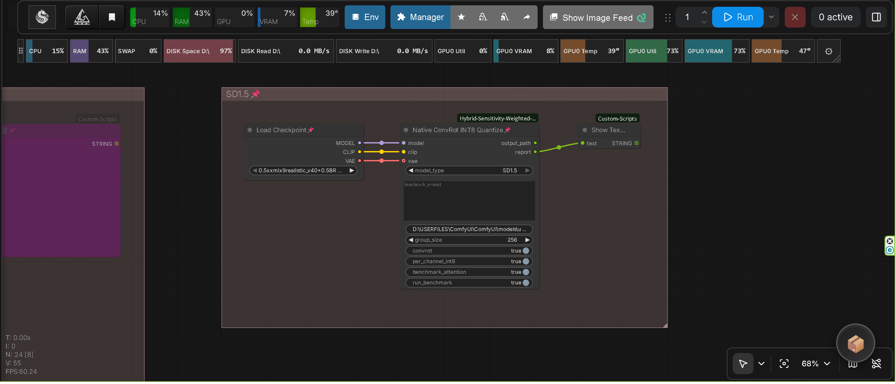

# How to quantize SD1.5 (Native ConvRot INT8)

Quantize **Stable Diffusion 1.5 (SD1.5)** checkpoints to **Native ConvRot INT8** via CLI (`sd1.5/native_convert_int8_sd1.5.py`) or directly in ComfyUI using the dedicated custom node **`Native ConvRot INT8 Quantize`** (`comfyui_nodes/`, `model_type = "SD1.5"`).

<p align="center">
  
</p>

---

## Architectural Rationale: Native ConvRot INT8 Only

For SD1.5 models, **Native ConvRot INT8 is the only supported and recommended quantization mode**. HSWQ hybrid precision (retaining selected sensitive layers in FP16) is deliberately omitted for the following reasons:

1. **Model Payload & Size Economy:**
   Standard SD1.5 checkpoints occupy approximately **1.9 GB** in FP16. Full INT8 quantization halves the UNet down to roughly **850–950 MB** (after removing the embedded VAE). Applying FP16 sensitivity protection to even a handful of ResBlock/Attention layers adds 200–350 MB back to the payload, completely defeating the primary purpose of quantizing a lightweight model.
2. **Diminishing Returns on Trajectory Fidelity:**
   Empirical measurements on SD1.5 show that FP16 protection yields negligible improvements in latent trajectory alignment. Native ConvRot INT8 alone routinely achieves **mean latent trajectory cosine similarity $\ge 0.97$**, rendering hybrid FP16 retention redundant.
3. **Embedded VAE Removal:**
   Standard SD1.5 checkpoints bundle the VAE (`first_stage_model.*`), consuming 160–330 MB of redundant storage. The quantization process **automatically strips the embedded VAE** from the output checkpoint to maximize compression. At inference time, connect an external SD1.5 VAE (e.g., `vae-ft-mse-840000-ema-pruned.safetensors`).

---

## Clone & Environment Setup

```bash
git clone https://github.com/ussoewwin/Hybrid-Sensitivity-Weighted-Quantization.git
cd Hybrid-Sensitivity-Weighted-Quantization
```

### 1. Install PyTorch (CUDA)

```bash
pip install torch torchvision --index-url https://download.pytorch.org/whl/cu130
```

### 2. Install Dependencies

```bash
pip install -r requirements.txt
pip install -U comfy_kitchen
pip install diffusers accelerate tqdm safetensors
```

- `comfy_kitchen` provides the fast quantization kernels, memory layouts, and online Hadamard activation rotation.
- `diffusers` is required if running optional Card 1 calibration (`--bias_correction`).

---

## Method 1: Quantize via ComfyUI Node (Recommended)

Quantization can be executed directly within ComfyUI using the custom node **`Native ConvRot INT8 Quantize`** from `comfyui_nodes/`.

<p align="center">
  
</p>

### Node Parameters

| Parameter | Type | Default | Description |
|---|---|---|---|
| **`model_type`** | Dropdown | `SD1.5` | Target architecture selector. Sets latent dimensions to 4-channel, 512×512 resolution, DPMPP 2M / Karras sampler defaults. |
| **`model`** | MODEL | (Required) | Connect from standard `Load Checkpoint`. |
| **`clip`** | CLIP | (Required) | Connect from `Load Checkpoint` for benchmark evaluation. |
| **`vae`** | VAE | (Optional) | Optional VAE connection. |
| **`benchmark_prompt`**| STRING | Default prompt | Conditioning text used during trajectory comparison. |
| **`output_path`** | STRING | (Empty) | Output path for the quantized `.safetensors`. Defaults to ComfyUI output directory. |
| **`group_size`** | INT | `256` | ConvRot Hadamard transform group size (must be a power of 4, $\ge 4$). |
| **`convrot`** | BOOLEAN | `true` | Enables FULL ConvRot rotation on Linear and Conv2d weights. |
| **`per_channel_int8`**| BOOLEAN | `true` | Per-channel scaling for kitchen dequantization. |
| **`benchmark_attention`**| BOOLEAN | `true` | Tests attention performance in the benchmark. |
| **`run_benchmark`** | BOOLEAN | `true` | Automatically executes the deterministic 25-seed latent trajectory benchmark immediately after saving. |

---

## Method 2: Quantize via CLI Script

For headless environments or batch pipelines, use `sd1.5/native_convert_int8_sd1.5.py`.

```bash
python sd1.5/native_convert_int8_sd1.5.py \
    --model "D:/models/checkpoints/v1-5-pruned-emaonly.safetensors" \
    --output "D:/models/checkpoints/v1-5-pruned-emaonly_convrot_int8.safetensors" \
    --per_channel_int8 \
    --convrot \
    --groupsize 256
```

### CLI Arguments

- **`--model` / `--input`:** Path to the input SD1.5 `.safetensors` file (full checkpoint or UNet-only).
- **`--output`:** Path where the quantized INT8 checkpoint will be saved.
- **`--convrot` / `--no-convrot`:** Enables/disables FULL ConvRot Hadamard rotation on all eligible Linear and Conv2d layers. (Default: **ON**).
- **`--groupsize`:** Hadamard group size (power of 4, default: `256`). Adaptive power-of-4 divisors (gs256, gs64, gs4) are selected based on input feature dimension.
- **`--per_channel_int8`:** Per-out-channel scale packaging (`int8_tensorwise`).
- **`--bias_correction`:** (Optional) Enables Card 1 activation-mean bias correction (`bias += -(W_q - W) @ mu_x`). Requires `--calib_file <prompts.txt>`.
- **`--fp_keep_layers`:** (Optional, default `0`) Keeps top-N layers in original FP16 based on static requant error ranking. Recommended to leave at `0` for pure native INT8.

---

## Validation & Quality Gates (Latent Trajectory)

Fidelity is measured strictly via **deterministic latent-space trajectory divergence**, comparing step-by-step intermediate latents ($x_t$) between the FP16 baseline and the quantized model under identical initial noise.

> **Why Latent Trajectory over Pixel SSIM:**  
> Conventional decoded SSIM (~0.95–0.98) can be severely misleading on diffusion models because the non-linear VAE decoder smooths high-frequency noise and masks structural degradation. Evaluating raw latent trajectories eliminates decoder bias.

### Benchmark Setup

- **Resolution:** 512 × 512 (4 latent channels)
- **Sampler / Scheduler:** `dpmpp_2m` / `karras`
- **Steps & CFG:** 25 steps, CFG = 7.0
- **Seeds:** 25 random deterministic seeds

### Metric Criteria

| Metric | Target | Description |
|---|---|---|
| **Cosine Mean** | **$\ge 0.96$** (typically ~0.97) | Average cosine similarity of final latent representations ($x_0$) across all 25 seeds. |
| **Max Step Drop**| **$\le 0.05$** | Maximum step-to-step cosine drop. A drop $> 0.05$ flags trajectory **bifurcation** (structural divergence). |
| **Bifurcated Seeds**| **0 / 25** | The model must never produce a bifurcated trajectory across the canonical seed set. |

---

## ComfyUI Inference Workflow

1. Load the quantized `.safetensors` file using standard ComfyUI loader:
   - **`Load Checkpoint`** or **`Load Diffusion Model`** (the format is natively recognized as `int8_tensorwise` via ComfyUI's internal quantization dispatcher).
2. Connect an external **SD1.5 VAE** (`Load VAE` $\rightarrow$ `VAE Decode`) since embedded VAE weights were removed during quantization.
3. Sample normally using standard samplers (Euler, DPM++ 2M, etc.). No custom loaders are required.
