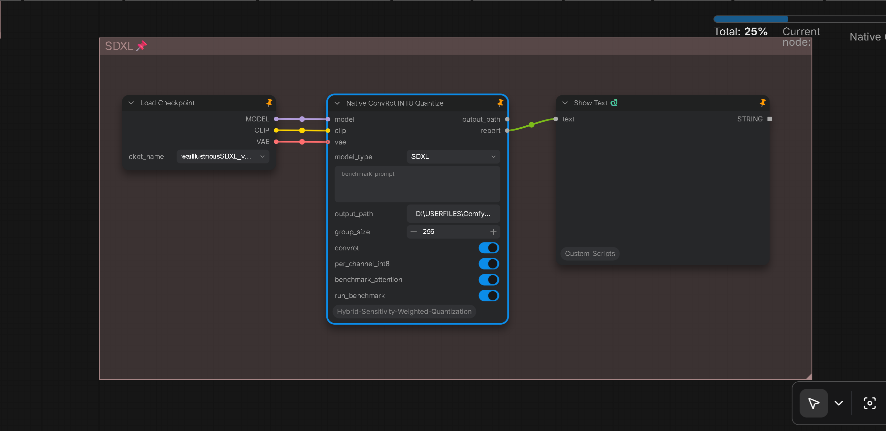

# How to quantize SDXL (Reverse Hybrid ConvRot INT8, v1.1)

> **Prerequisite**: the original **FP16 SDXL checkpoint** (`<base>`). Nothing else is imported.

This method is the **existing HSWQ SDXL selector extended with a reverse (trajectory-impact) step** —
not a replacement for it. The selector's protection pipeline stays as it is (calibration with
**Dual Monitor hooks**, **weighted-histogram MSE V4**, **full SVD**, the **300 MiB payload budget** and
the key-pattern veto) and it still decides which layers are protected and stay at FP16. What the
reverse step adds is the selection inside the pool the selector leaves: the **diag** step measures the
trajectory impact of every remaining pool layer (Step 1), and the converter turns the **K lowest-impact
pool layers into ConvRot INT8 in ascending impact order**, while **every other layer is kept at FP16**
(the original dtype and size) — the selector-protected layers included.

Why the added step: the selector's protection is a **static** decision (weights / activation statistics
plus the fixed payload budget), whereas the reverse step supplies the **dynamic** criterion for the
rest of the pool by measuring the actual end effect of quantizing one layer — the drift of a fixed
denoising trajectory, i.e. that layer's FP16-vs-ConvRot-INT8 error propagated through the sampler. This
keeps the decision in the low-error regime where single-layer ranking is valid (see
`md/diag_impact_trajectory_sensitivity_technical_guide.md`). Keeping the high-impact layers (the
selector-protected ones plus the higher-impact pool layers) in FP16 is what lifts the hybrid above a
full INT8 pack at the same quality level.

**Converter: `sdxl/gen_reverse_int8_sdxl_v1.1.py`.** It uses the artifact-era boundary set (module
names containing `conv_in.` / `conv_out.` / `time_embed.` / `add_embedding.` / `label_emb.` are never
converted) and writes the same on-disk layout as the shipped ConvRot INT8 packs. The variant with the
newer boundary set lives in `sdxl/gen_reverse_int8_sdxl.py`; the one-command driver selects v1.1 with
`--legacy-gen`.

**Candidate premise (HSWQ V3.1 selector).** The production pipeline does not measure all eligible
layers: Step 1 runs the permitted V3.1 selector (`--artifact v31`) and measures only the pool it
leaves. V3.1 itself decides which layers stay FP16 (calibration with Dual Monitor hooks +
weighted-histogram MSE V4 + full SVD + a **300 MiB payload budget**, plus the key-pattern veto), and
those layers are excluded from the pool, so they stay FP16 in the hybrid. **That protection is the invariant to preserve**: on the reference
checkpoint the selector keeps **77 matmul layers** at FP16 (73 non-boundary + 4 boundary), and a valid
hybrid keeps all 77 FP16 with weights byte-identical to the base.

Validation is done with the deterministic 25-seed latent-trajectory comparison
(`benchmark/sdxl_int8_traj_compare.py`): identical noise per seed for both models, per-step latent
cosine, bifurcation detection. The production gate is **cosine mean ≥ 0.95 and 0/25 bifurcated**.

Scores are **checkpoint-specific**: the impact ranking, `K`, and the trajectory numbers must be
re-measured for every model and are **not transferable**.

---

## Judgement criteria (read first)

The production quality gate is the deterministic per-step latent trajectory comparison
(`benchmark/sdxl_int8_traj_compare.py`), not a decoded image SSIM. It samples the FP16 baseline and
the quantized model from identical noise (same seed) and compares the latent trajectories step by
step.

| Metric | Threshold | Meaning |
|---|---|---|
| **final-cos** | — | final-step latent cosine (same seed, FP16 vs quantized) |
| **max-step-drop** | **> 0.05** | that seed is **bifurcated** (sudden trajectory jump = different picture, not degradation) |
| **same-image** | **≥ 0.98** | final cosine high enough to call it the same picture |
| **PASS** | **mean ≥ 0.95 AND bifurcated = 0/25** | production gate for 25 random seeds × 25 steps |

- **Fixed 25-seed random set** (the script default — always use it; do not cherry-pick seeds):
  `42,137,849,2024,7391,18429,53082,149206,382715,826401,1938502,4710928,8391642,15820493,`
  `36192847,71058294,128491703,285039184,491730285,762019483,938174026,1409285713,2683910547,3851729406,4195820371`
- **Fixed steps:** `--steps 25` (the script default is 25 — pass it explicitly).
- **Fixed prompt / CFG / sampler / size:** script defaults
  (`masterpiece, best quality, 1girl, solo, standing, simple background` / cfg 7.0 / dpmpp_2m / karras /
  1024×1024) — do not change.
- `drifted (different image)` is **normal** (small acceptable divergence). Only **bifurcated** and
  mean < 0.95 fail a configuration.
- The FP16 baseline branch of the benchmark always loads stock (no INT8 patch); the INT8 branch arms
  the quantized path automatically when the checkpoint carries `.comfy_quant` markers.

---

## 0. Prerequisites

| Requirement | Notes |
|---|---|
| CUDA GPU, **≥ 12 GB VRAM** | run **one process at a time**; concurrent runs exhaust VRAM |
| Python with **PyTorch (CUDA)** | the exact install command depends on your CUDA version |
| This repository | clone it; it bundles the ComfyUI checkout in `ComfyUI-master/` (read-only — never modify it) |
| Runtime packages | `pip install -r requirements.txt` (ComfyUI runtime) and `pip install -U comfy_kitchen` (INT8 layouts) |
| Base checkpoint | the original fp16 SDXL `.safetensors` (`<base>`, UNet + CLIP + VAE in one file) |
| Calibration prompts | a prompt list, e.g. `sample/calibration_prompts_128.txt` — required by Step 1 (`--artifact v31`) and by Step 2 when `--bias_correction` is used |
| Disk | keep **≥ 20 GB free** (base 6.9 GB + hybrid 4.4–6.9 GB + the V3.1 selector pack + one intermediate) |
| Optional | `scikit-image` only if you also run the legacy decoded-image bench `benchmark/int8bench_sdxl.py` |

### Environment Setup

```bash
pip install torch torchvision --index-url https://download.pytorch.org/whl/cu130
pip install -r requirements.txt
pip install -U comfy_kitchen
```

A **VAE is not needed** for the validation: the trajectory comparison works in latent space (no
decoded-SSIM step). On Windows, set `PYTHONIOENCODING=utf-8` in the shell to avoid cp932 decode
errors; never set `TORCH_LOGS` (torch import fails with an AttributeError).

## Paths (replace every `<...>` with a real path on your machine)

| Placeholder | Meaning |
|---|---|
| `<base>` | base fp16 SDXL checkpoint `.safetensors` (e.g. `waiIllustriousSDXL_v170.safetensors`) |
| `<impact>.json` | **created by Step 1** at `<repo>/impact/impact_<model>.json` — never downloaded, never copied from another model |
| `protect_<stem>.json` | **created by Step 1** — the V3.1 selector's protected (FP16-kept) layer list, written next to `<impact>.json` |
| `<stem>hswq_r32_1off_convrot_int8_repro.safetensors` | **created by Step 1** — the V3.1 selector's own pack, written next to `<base>` (its converted set defines the pool) |
| `<hybrid>` | hybrid output of Step 2 (a name you pass on the command line, e.g. `<model>_rev_int<K>_convrot_int8.safetensors`) |
| `<K>` | integer: how many lowest-impact pool layers to request (search this; not fixed) |
| `<comfy_path>` | folder that contains `comfy/` (bundled: `ComfyUI-master`) |

**Path handling:** run everything from the repository root and pass paths **relative to the current
directory** (or absolute). Relative paths are forwarded unchanged to the child processes, so a path
that already contains the repository folder name resolves to a doubled path and fails with
`FileNotFoundError`.

## Overall flow

```
<base>  (original FP16, 6.94 GB)
  │ Step 1: sdxl/diag_impact_sdxl.py "<base>" "<impact>.json" \
  │              --artifact v31 --calib_file "<prompts>" --comfy_path "<comfy_path>" \
  │              --num_calib_samples 32 --num_inference_steps 25 --steps 25 --seed 42
  ▼        (json lands in <repo>/impact/; also writes protect_<stem>.json and the Step-1 repro pack)
<impact>.json  (pool only: 715 layers on the reference checkpoint = 788 eligible − 73 protected)
  │ Step 2: sdxl/gen_reverse_int8_sdxl_v1.1.py <K> "<hybrid>" "<base>" "<impact>.json" \
  │              --bias_correction --calib_file "<prompts>" --comfy_path "<comfy_path>"
  ▼
<hybrid>  (K lowest-impact pool layers → ConvRot INT8, everything else stays FP16)
  │ Step 3: benchmark/sdxl_int8_traj_compare.py --fp16 "<base>" --int8 "<hybrid>" --steps 25  (25 random seeds)
  ▼
PASS iff final-cosine mean ≥ 0.95 and 0/25 bifurcated  →  else change <K> (Step 4)
  ▼
Step 5: upload + cleanup
```

---

---

## Method 1: CLI pipeline (full reverse-hybrid flow, Steps 1-5)

## Step 1. Create `<impact>.json` (per-layer trajectory impact, V3.1 candidate premise)

```bash
python sdxl/diag_impact_sdxl.py "<base>" "impact/impact_<model>.json" \
  --comfy_path "<comfy_path>" \
  --artifact v31 \
  --calib_file "sample/calibration_prompts_128.txt" \
  --num_calib_samples 32 --num_inference_steps 25 \
  --steps 25 --seed 42
```

- `--artifact v31` first runs the permitted V3.1 selector (`sdxl/build_protect_list_sdxl.py` →
  `sdxl/quantize_sdxl_hswq_v3.1.py`): calibration with Dual Monitor hooks over `--num_calib_samples`
  prompts × `--num_inference_steps` steps, weighted-histogram MSE V4 + full SVD, the 300 MiB payload
  budget and the key-pattern veto. It writes the selector pack `<stem>hswq_r32_1off_convrot_int8_repro.safetensors`
  next to `<base>` and the protected list `protect_<stem>.json` next to the impact json, then measures
  **only the pool the selector left** (715 of the 788 eligible layers on the reference checkpoint).
- Every ConvRot-eligible Linear/Conv2d of the checkpoint is a candidate; boundary layers
  (`input_blocks.0.0`, `out.*`, `time_embed.*`, `add_embedding.*`, `label_emb.*`) are always excluded.
  For each pool layer the script injects that layer's ConvRot INT8 reconstruction
  (`dequant(per-channel INT8(quantize(W @ H^T)))` — the ConvRot INT8 kernel, **no inverse rotation**),
  runs a fixed-seed denoising trajectory and records how far the final latent drifts (relative MSE).
  That is the layer's **real importance under trajectory propagation**.
- Two independent parameter groups:
  - `--steps` / `--seed` / `--width` / `--height` / `--prompt` = the **trajectory measurement**. The
    production measurement uses `--steps 25 --seed 42`. The ranking depends on these values, so keep
    them fixed for every checkpoint you intend to compare, and do not compare rankings measured with
    different `--steps`.
  - `--calib_file` / `--num_calib_samples` / `--num_inference_steps` = the **V3.1 selector calibration**
    (only used with `--artifact v31`).
- Progress prints `[25/715] [50/715] ...`. The first line can take a few minutes (checkpoint load +
  CLIP conditioning + reference trajectory).
- Writes `{"x_ref_norm": ..., "steps": ..., "seed": ..., "cfg": ..., "sampler": ..., "scheduler": ...,
  "base": ..., "impacts": {<layer>: <rel MSE>, ...}}`. Without `--artifact`, every eligible layer is
  measured (788 on the reference checkpoint) instead of the pool.

---

## Step 2. Reverse hybrid conversion with v1.1 (`<K>` lowest-impact layers → ConvRot INT8)

```bash
python sdxl/gen_reverse_int8_sdxl_v1.1.py <K> \
  "<hybrid>" \
  "<base>" "<impact>.json" \
  --out-dir "<output-dir>" --groupsize 256 \
  --bias_correction \
  --calib_file "sample/calibration_prompts_128.txt" \
  --comfy_path "<comfy_path>" \
  --num_calib_samples 32 --num_inference_steps 25
```

What it does:

1. Ranks layers by `<impact>.json` **ascending** (lowest impact = safest first).
2. For the first **K** ranked pool layers (skipping boundary layers): `W @ H^T` → per-channel INT8
   (Linear: rowwise `[out,1]`; Conv2d: channelwise `[out,1,1,1]`) → stores the **rotated INT8 weight**
   — the ConvRot INT8 kernel, **without re-rotation**.
3. Replaces those layers with `.weight` (I8) / `.weight_scale` (F32) / `.comfy_quant` (U8 tensor).
   **All other layers are copied unchanged from the FP16 baseline** (original dtype and size) —
   including every layer the V3.1 selector protected.
4. Prints progress and a final summary:
   `converted: <N>, protected-skip: <N>, not-found-skip: <N>, shape-skip: <N>`
   (plus `UNet key prefix: '...'` at load time).

**On-disk format of converted layers:**
`.weight` I8 (Linear `[out, in]`, Conv2d `[out, in, kH, kW]`) + `.weight_scale` F32
(Linear `[out,1]`, Conv2d `[out,1,1,1]`) + `.comfy_quant` conf
`{"format": "int8_tensorwise", "convrot": true, "convrot_groupsize": N}`. Weights are **stored
rotated** (a large dequant-vs-fp16 deviation is expected).

ComfyUI's mixed-precision ops select the quantized path per layer from the `.comfy_quant` marker, so
one file carries both the FP16-kept and the ConvRot INT8 layers.

### Bias correction (`--bias_correction`)

- ConvRot INT8 quantizes the **rotated** weight and the runtime rotates the activation online
  (`x_rot = x @ H`), so the systematic output shift of a converted layer is
  `delta[o] = sum_j (W_q_rot - W_rot)[o, j] * E[x_rot][j]`.
- The converter collects `E[x_rot]` for each converted layer with forward pre-hooks during
  `--num_calib_samples` calibration passes through the **production sampler**
  (dpmpp_2m / karras / cfg 7.0, fixed `--calib_seed`), then adds `-delta` to that layer's existing
  `.bias`. Layers without a `.bias` are skipped; size and format are unchanged.
- **Model-dependent:** bias correction can help or hurt. Measure both variants with the 25-seed gate
  (Step 3) before shipping.
- The final log line `bias correction: applied=<N>, no_bias=<N>, no_act=<N>` confirms the effect:
  expect `applied > 0` and `no_act = 0` (a non-zero `no_act` means the calibration hooks did not reach
  those layers — the file would be identical to the non-corrected one).

### Size (reference checkpoint)

The FP16 base is 6.94 GB (6.46 GiB). Each converted layer drops roughly **3.1 MB** on average, so the
hybrid size is `base − K × ~3.1 MB`, minus the embedded VAE (about **0.16 GB**) that is no longer
written since v2.3.7. Measured with the VAE still embedded: **K = 670 with bias correction → 4,875,339,410 B
(4.54 GiB)**. Measured after the removal: **K = 597 → 4,923,161,506 B (4.92 GB / 4.59 GiB)**.

---

## Step 3. Trajectory validation of the hybrid (25 random seeds × 25 steps)

```bash
python benchmark/sdxl_int8_traj_compare.py \
  --fp16 "<base>" \
  --int8 "<hybrid>" \
  --comfy_path "<comfy_path>" \
  --seeds "42,137,849,2024,7391,18429,53082,149206,382715,826401,1938502,4710928,8391642,15820493,36192847,71058294,128491703,285039184,491730285,762019483,938174026,1409285713,2683910547,3851729406,4195820371" \
  --steps 25 \
  --width 1024 --height 1024
```

```
========================================================================
Deterministic per-step latent trajectory divergence (FP16 vs ConvRot INT8)
========================================================================
[seed 42] final-cos=0.99666  max_step_drop=0.0005  -> same-image
...
--- Multi-seed summary ---
final-cosine: min=... mean=... max=...
same-image seeds : N/25
bifurcated seeds : N/25   (sudden trajectory jump = different picture, not degradation)
```

- **PASS** iff `mean ≥ 0.95` and `bifurcated seeds : 0/25`.
- Report the **entire block** (every per-seed line plus the summary).
- Runs are deterministic for a fixed seed set **on a quiet GPU**; other GPU processes can change the
  numbers (ComfyUI picks different attention/offload paths depending on free VRAM). Run one process
  at a time.
- Single runs are noisy at small seed counts; always use the **full 25-seed set** for a verdict.

---

## Step 4. Finding K

`K` is checkpoint-specific, and the quality surface is often **not a single cliff** (failing seeds
change with K). Search **sequentially, 10 at a time, one process at a time**:

1. Start at **K = 60** → Step 2 → Step 3.
2. Passes (mean ≥ 0.95, 0/25 bifurcated) → raise K by 10 and repeat. The answer is the **largest K
   that still passes** — keep raising until it fails.
3. Fails → lower K by 10 until it passes; that K is the answer.
4. **Any K with bifurcated > 0 is rejected**, even if the mean ≥ 0.95.
5. If a **size cap** is required, note that quality decreases monotonically with K: choose the
   smallest K whose size fits the cap, then confirm it still passes the gate — if the cap forces K
   above the passing range, the cap is not achievable with this method for that checkpoint (the
   FP16-kept layers are the precision reserve).

Notes for the V3.1 premise:

- `K` counts ranked **pool** entries; layers skipped as boundary / not-found / ineligible do not
  convert, so the final `converted:` count can be below K. `K` larger than the pool is capped by the
  pool size (715 on the reference checkpoint).
- Measured reference point (reference checkpoint, `--artifact v31`, `--bias_correction`):
  **K = 670 → mean final-cos 0.96241, 0/25 bifurcated, 4.54 GiB (size measured before the embedded-VAE removal)**. Re-measure for every other
  checkpoint; do not transfer this value.

---

## Step 5. Upload and cleanup

Upload the final hybrid (`<hybrid>`) to Hugging Face — the file needs no extra packing; ComfyUI loads
it directly (mixed precision ops arm the INT8 layers from `.comfy_quant`). The `upload.py` template in
the repo root uploads a file with `huggingface_hub`; edit the values at the top (username, repo, your
**Write**-capable token, file path, in-repo filename), then run `python upload.py`.

**Keep:** `<base>`, `impact/impact_<stem>.json`, `protect_<stem>.json`, and the final `<hybrid>` (production
artifact).
**Delete:** intermediate hybrids from rejected K values.

---

## Method 2: ComfyUI Nodes

### 1. `HSWQ SDXL Diag Impact` + `HSWQ Quantize ConvRot INT8` (Recommended In-Workflow)

<p align="center">
  
</p>

> **Sample Workflow:** [`sample workflow/hswq sdxl convrot int8.json`](../sample%20workflow/hswq%20sdxl%20convrot%20int8.json)

In-workflow SDXL reverse-hybrid pipeline (`comfyui_nodes/hswq_sdxl_diag_impact.py` +
`comfyui_nodes/hswq_sd15_quantize.py` with `model_type = "SDXL"`). Runs the complete
Step 1 (diag impact) / Step 2 (reverse hybrid) / Step 3 (25-seed gate) chain directly
within ComfyUI, without manual terminal commands.

#### Node Setup & Wiring

1. **`Load Checkpoint`**: Load the target SDXL FP16 checkpoint (e.g. `waiIllustriousSDXL_v170.safetensors`).
   - Connect **`MODEL` / `CLIP` / `VAE`** to **`HSWQ SDXL Diag Impact`** (`model` / `clip`) and to **`HSWQ Quantize ConvRot INT8`** (`model` / `clip` / `vae`).
2. **`HSWQ SDXL Diag Impact`** (category `HSWQ/Quantize`): runs the Step 1 measurement for the connected MODEL.
   - Connect its **`impact_json`** output → `Switch (Any)` `input1`.
   - Widget values (production recipe): `steps 25` / `seed 42` / `width 1024` / `height 1024` / `cfg 7.0` / `sampler dpmpp_2m` / `scheduler karras` / `group_size 256`.
   - This stage is the slow one (715 pool layers × 25-step trajectories; the per-step sampling bar is now visible in the log).
3. **`HSWQ Load Diag Impact Json`** (category `HSWQ/Quantize`): lists the stored impact jsons (`impact_*.json` under `<repo>/impact/`) in a dropdown — reuse a measurement without re-running Step 1.
   - Connect its **`impact_json`** output → `Switch (Any)` `input2`.
   - Use this input when the model was already measured with the SAME recipe (`steps 25 / seed 42`); the node refuses files that do not carry an `impacts` dict and `steps`/`seed`.
4. **`Switch (Any)`**: `select` = 1 → Step 1's fresh measurement; `select` = 2 → the stored json from the loader node.
5. **`HSWQ Quantize ConvRot INT8`** (`model_type = "SDXL"`): consumes `model` / `clip` / `impact_json` (from the Switch) and runs Step 2 → Step 2b (CLIP ConvRot INT8) → Step 3 (gate).
   - Connect **`output_path` / `report`** → `Show Text` to view live logs and the final trajectory-gate scores.

#### Node Parameters (HSWQ Quantize ConvRot INT8, model_type=SDXL)

| Parameter | Default / Recommended | Description |
|---|---|---|
| `model_type` | `SDXL` | Target architecture family (dropdown). |
| `output_path` | *(empty)* | Output `.safetensors` path. If empty, writes to `<ComfyUI>/output/<stem>_rev_int<K>_convrot_int8_<timestamp>.safetensors`. |
| `calib_file` | `128` | Calibration prompts sheet from `sample/` (used by Step 2 bias correction). |
| `num_calib_samples` | `32` | Mandatory r32 recipe. |
| `num_inference_steps` | `25` | Steps per calibration sample. |
| `group_size` | `256` | ConvRot Hadamard rotation block size (power of 4). |
| `bias_correction` | `true` | Step 2 systematic INT8 bias cancellation (script reference flow uses it). |
| `run_benchmark` | `true` | Automated 25-seed deterministic trajectory gate on the FINAL pack (CLIP INT8 included). |
| `impact_json` | — | Input terminal: the Step 1 impact json (fresh or stored). |
| `k_layers` | `60` | K lowest-impact pool layers to convert (search per checkpoint, one process at a time). |

Widgets used only by the SD1.5 branch (`fp16_budget_mb`, `convrot`) are ignored in the SDXL branch.

#### In-Workflow Execution Steps

1. Enable exactly one of the two measurement sources via the **`Fast Groups Bypasser V2`** (`Enable: Diag Impact` for the fresh Step 1 run / `Enable: Load json` for the stored-json path — the disabled side must be bypassed; the stored loader node stays bypassed by default).
2. Click **Queue Prompt**. The graph then runs: Step 1 (or json load) → Step 2 (UNet reverse hybrid, K lowest-impact layers) → Step 2b (CLIP ConvRot INT8, 133 layers / 38 protected) → Step 3 (25-seed gate).
3. The trailing log lines and the final gate block (per-seed final-cos + `mean/bifurcated/same-image` summary) appear in the `Show Text` node. **PASS** iff mean ≥ 0.95 and 0/25 bifurcated; otherwise lower K and re-run Step 2/3 (the stored json can be reused for every K).

---

## Method 3: Native ConvRot INT8 (A/B baseline)

### 1. `Native ConvRot INT8 Quantize` ComfyUI Node (model_type = "SDXL")

<p align="center">
  
</p>

> **Sample Workflow:** [`sample workflow/native convrot int8.json`](../sample%20workflow/native%20convrot%20int8.json)

The shared native node (`comfyui_nodes/native_convrot_int8_convert.py`, engine
`sdxl/native_convert_int8_sdxl.py`) supports SDXL alongside the other families:

| Parameter | Value | Description |
|---|---|---|
| `model_type` | `SDXL` | Native engine branch (`native_convert_int8_sdxl.py`). |
| `model` / `clip` | — | MODEL + CLIP inputs: connect a standard `Load Checkpoint`. |
| `vae` | *(optional VAE input)* | VAE forward hook setup; pass it when the source checkpoint bundles one. |
| `benchmark_prompt` | *(default)* | Prompt used by the in-node post-convert benchmark. |
| `output_path` | *(empty)* | Output path of the native pack (`<stem>_native_convrot_int8.safetensors`). |
| `group_size` | `256` | ConvRot Hadamard group size. |
| `convrot` | `true` | FULL ConvRot rotation on all converted layers. |
| `per_channel_int8` | `true` | Per-channel weight scales. |
| `benchmark_attention` | `true` | Run the in-node benchmark attention paths. |
| `run_benchmark` | `true` | In-node post-convert benchmark (latent trajectory). |

Wiring:

```
[Load Checkpoint] ─MODEL/CLIP(/VAE)→ [Native ConvRot INT8 Quantize]
```

After queueing, the node runs the same engine as the CLI method and prints the
conversion summary (converted layer count, INT8/F16 split, module breakdown) plus the
in-node benchmark into the log.

### 2. Native CLI (equivalent)

```bash
python sdxl/native_convert_int8_sdxl.py \
    --model  "<path-to-unet>/<sdxl_unet>.safetensors" \
    --output "<path-to-unet>/<sdxl_unet>_native_convrot_int8.safetensors" \
    --per_channel_int8 --convrot --groupsize 256
```

### HSWQ vs native (trajectory baseline)

Deterministic per-step latent trajectory comparison (`benchmark/sdxl_int8_traj_compare.py`)
is the sole production gate — legacy decoded-image MSE / SSIM is fully deprecated.

Under trajectory evaluation, **Native ConvRot INT8 (which converts all layers to INT8)
never exceeds HSWQ reverse hybrid**, because HSWQ selectively preserves the most
sensitive and trajectory-critical layers at FP16. On the reference checkpoint, a native
full pack measures ≈ **0.93** mean final-cosine at 25 seeds; HSWQ reverse hybrid strictly
surpasses it (production gate: mean ≥ **0.95** and 0/25 bifurcated). Native ConvRot INT8
serves purely as an A/B baseline to confirm the margin and quality lift provided by the
reverse hybrid.

## Troubleshooting

| Symptom | Cause / fix |
|---|---|
| `UnicodeDecodeError 'cp932'` | Windows locale issue; set `PYTHONIOENCODING=utf-8` in the shell |
| torch import `AttributeError ... get_log_level_pairs` | `TORCH_LOGS` is set; unset it and never set it |
| `--artifact v31 requires --calib_file` | Step 1 needs the calibration prompt file whenever `--artifact v31` is used |
| `FileNotFoundError: .../<repo>/<repo>/sample/calibration_prompts_128.txt` | the path passed on the command line already contained the repository folder name while the working directory was already the repository root; pass `sample/calibration_prompts_128.txt` (relative to the current directory) or an absolute path |
| `ModuleNotFoundError: No module named 'comfy'` | `--comfy_path` must point at the folder that contains `comfy/` (e.g. the bundled `ComfyUI-master`); the converter bootstraps `sys.path` from it before importing comfy |
| `impact_*.json` missing | Created by Step 1 in `<repo>/impact/`; the second positional arg of `diag_impact_sdxl.py` is the **output** path |
| 0 layers converted / many `SKIP (not in sd)` | impact keys and checkpoint keys did not resolve — verify the impact json was produced from the **same** checkpoint |
| many `SKIP (boundary layer)` | the ranked entries fall on the boundary set (`conv_in.` / `conv_out.` / `time_embed.` / `add_embedding.` / `label_emb.`); this is expected and simply shrinks the converted count |
| `UNet key prefix: ''` | the checkpoint does not use the `model.diffusion_model.` / `diffusion_model.` layout |
| `save_file` ValueError | `.comfy_quant` must be a **U8 tensor**, not raw bytes (handled inside the script) |
| Sampling crawls (~1.1 it/s) and reserved VRAM balloons to ~17 GiB during calibration | `backend:cudaMallocAsync` (auto-appended by ComfyUI on cu13 torch) does not return freed blocks from the Diffusers calibration churn; the selector script strips it at import (measured: reserved 17.00 → 10.28 GiB). If you set the allocator yourself, omit `backend:` |
| final cosine collapses | `K` beyond the checkpoint's boundary — lower K (Step 4) |
| mean ≥ 0.95 but bifurcated > 0 | Reject this K; lower K by 10 (high-impact layers are breaking) |
| Numbers differ from a previous run | another GPU process was running, or `--steps` / seed set / machine differed; re-run on a quiet GPU with the fixed 25-seed set |
| Process won't die | Kill the whole process tree (`taskkill /PID <parent> /T /F` on Windows) |

## Files in this repo

| File | Purpose |
|---|---|
| `sdxl/diag_impact_sdxl.py` | Step 1 — per-layer ConvRot INT8 trajectory impact (optionally over the V3.1 pool) → `<impact>.json` |
| `sdxl/build_protect_list_sdxl.py` | Step 1 helper — runs the permitted V3.1 selector and derives `protect_<stem>.json` (the FP16-kept layer list) |
| `sdxl/quantize_sdxl_hswq_v3.1.py` | the V3.1 selector itself (calibration + weighted-histogram MSE + full SVD + 300 MiB budget) |
| `sdxl/gen_reverse_int8_sdxl_v1.1.py` | Step 2 — reverse hybrid converter, artifact-era boundary set (K lowest-impact layers → ConvRot INT8, rest FP16) |
| `sdxl/gen_reverse_int8_sdxl.py` | Step 2 alternative — same conversion with the newer boundary set |
| `sdxl/auto_reverse_int8_sdxl.py` | one-command driver (Step 1 → Step 2 → optional 25-seed gate); `--legacy-gen` selects v1.1 |
| `benchmark/sdxl_int8_traj_compare.py` | Step 3 — deterministic 25-seed per-step trajectory divergence (cosine, bifurcation) |
| `comfyui_nodes/hswq_sdxl_diag_impact.py` | ComfyUI node — HSWQ SDXL Diag Impact (Step 1 trajectory measurement) |
| `comfyui_nodes/hswq_sdxl_load_impact_json.py` | ComfyUI node — HSWQ Load Diag Impact Json (reuses saved impact JSON) |
| `comfyui_nodes/hswq_sd15_quantize.py` | ComfyUI node — HSWQ Quantize ConvRot INT8 (Step 2 UNet + Step 2b CLIP + Step 3 gate) |
| `sample workflow/hswq sdxl convrot int8.json` | ComfyUI sample workflow — HSWQ SDXL Reverse Hybrid ConvRot INT8 pipeline |
| `sample workflow/native convrot int8.json` | ComfyUI sample workflow — Native ConvRot INT8 baseline pipeline |

**Dependencies:** `comfy-kitchen` (INT8 layout), `safetensors`, plus the ComfyUI runtime
(`requirements.txt`, used via the bundled `ComfyUI-master/` tree). Run Steps 1–3 with
`--comfy_path "ComfyUI-master"` (or an absolute path).
