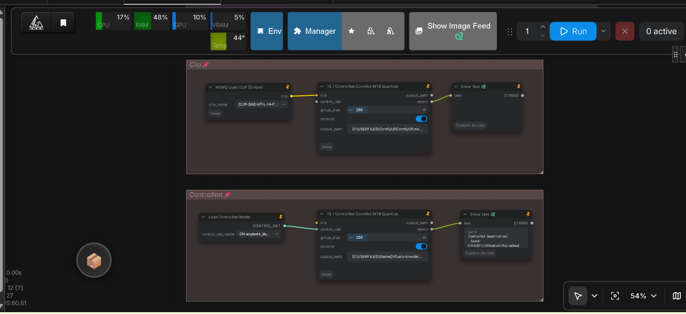
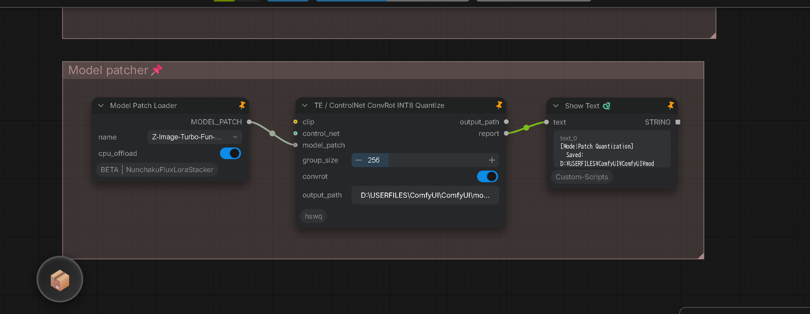
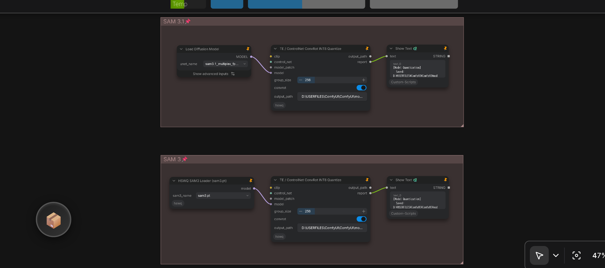

# How to quantize Text Encoder, ControlNet, Model Patch and SAM 3 / SAM 3.1

Quantize loaded **ControlNet / ControlNet Union models**, **Model Patch (model patcher) ControlNets**, and **Segment Anything Models (SAM 3 / SAM 3.1 Multiplex)** directly in ComfyUI using the dedicated custom node **`TE / ControlNet ConvRot INT8 Quantize`** (`comfyui_nodes/te_controlnet_convrot_int8_convert.py`) and loader **`HSWQ SAM3 Loader (sam3.pt)`** (`comfyui_nodes/sam3_pt_loader.py`), or via the standalone CLI conversion script **`clip_convert/convert_clip_convrot_int8.py`**.

By applying orthogonal Hadamard rotations prior to per-channel INT8 quantization, this pipeline eliminates activation outlier spikes in deep Linear layers, reducing VRAM and storage footprint by ~50% while preserving mask segmentation fidelity and structural guidance quality.

> [!IMPORTANT]
> **Text encoders and SAM are separate cases.** The generic CLI above quantizes every 2D Linear layer with **no FP16 protection** - it is the A/B baseline, not the recommended pack. HSWQ also publishes **individually built, higher-quality packs** (measured FP16 protection) for text encoders and SAM 3.1 on Hugging Face. Because text encoders and SAM are standards (one weight layout per architecture) rather than per-checkpoint models, these are finished artifacts rather than a universal method - see [**HSWQ High-Quality Text Encoders**](#hswq-high-quality-text-encoders-convrot-int8-individually-built) and [**HSWQ High-Quality SAM 3.1**](#hswq-high-quality-sam-31-convrot-int8-individually-built) below. (SAM 3 is the same kind of case but its pack is not published for license reasons.)

> [!IMPORTANT]
> **Text encoders are a separate case.** The generic CLI above quantizes every 2D Linear layer with **no FP16 protection** - it is the A/B baseline, not the recommended text-encoder pack. HSWQ also publishes **individually built, higher-quality text-encoder packs** (measured FP16 protection, verified by conditioning cosine) on Hugging Face. Because text encoders are standards (one weight layout per architecture) rather than per-checkpoint models, these are finished artifacts rather than a universal method - see [**HSWQ High-Quality Text Encoders**](#hswq-high-quality-text-encoders-convrot-int8-individually-built) below.

---

## ComfyUI Node Workflow

Quantization is performed directly in-graph from memory without requiring external CLI conversion scripts:

### Workflow Layouts

<p align="left">
  <b>1. Text Encoder & ControlNet Quantization:</b><br>
  
</p>

<p align="left">
  <b>2. Model Patch (Model Patcher) Quantization:</b><br>
  
</p>

<p align="left">
  <b>3. SAM 3 & SAM 3.1 Multiplex Quantization:</b><br>
  
</p>

---

### Sample Workflow

A ready-to-use ComfyUI workflow JSON covering all supported model types is provided in the repository:
- **[`sample workflow/native convrot int8.json`](../sample%20workflow/native%20convrot%20int8.json)**

You can load this file directly into ComfyUI (or drag-and-drop the workflow images above) to load the complete quantization graph.

---

### Pipeline Structure

The workflow consists of five specialized, parallel quantization branches:

1. **Text Encoder (CLIP / TE) Branch:**
   - **Loader:** `HSWQ Load CLIP (Simple)` (or standard `CLIPLoader` / `DualCLIPLoader` / `TripleCLIPLoader`).
   - **Quantizer:** `TE / ControlNet ConvRot INT8 Quantize` (connected via the `clip` input terminal).
   - **Monitor:** `Show Text` (Custom-Scripts) connected to `report` to display real-time quantization layer statistics and output path.

2. **ControlNet Branch:**
   - **Loader:** `Load ControlNet Model` (or `HSWQ Load ControlNet (Simple)`).
   - **Quantizer:** `TE / ControlNet ConvRot INT8 Quantize` (connected via the `control_net` input terminal).
   - **Monitor:** `Show Text` (Custom-Scripts) connected to `report` to display file size and layer breakdown.

3. **Model Patch (Model Patcher) Branch:**
   - **Loader:** `Load Model Patch` (`ModelPatchLoaderCustom` / stock `ModelPatchLoader`).
   - **Quantizer:** `TE / ControlNet ConvRot INT8 Quantize` (connected via the `model_patch` input terminal).
   - **Monitor:** `Show Text` (Custom-Scripts) connected to `report`.

4. **SAM 3.1 Branch (Multiplex Architecture):**
   - **Loader:** Standard **`UNetLoader`** (or `Load Diffusion Model`) loading `sam3.1_multiplex_fp16.safetensors` from `models/unet/` or `models/diffusion_models/`.
   - **Quantizer:** `TE / ControlNet ConvRot INT8 Quantize` (connected via the **`model`** input terminal).
   - **Monitor:** `Show Text` (Custom-Scripts) connected to `report`.

5. **SAM 3 Branch (Classic Non-Multiplex Architecture / sam3.pt):**
   - **Loader:** Dedicated **`HSWQ SAM3 Loader (sam3.pt)`** (`HSWQSAM3Loader`) loading `sam3.pt` or `sam3_fp16.safetensors`.
   - **Quantizer:** `TE / ControlNet ConvRot INT8 Quantize` (connected via the **`model`** input terminal).
   - **Monitor:** `Show Text` (Custom-Scripts) connected to `report`.

---

## SAM 3 vs. SAM 3.1 Architectural Differences

SAM 3 and SAM 3.1 have distinct internal network topologies and key layouts. The quantization engine incorporates explicit branching logic to ensure seamless compatibility:

| Architectural Feature | SAM 3 (`sam3.pt` / `sam3_fp16.safetensors`) | SAM 3.1 Multiplex (`sam3.1_multiplex_fp16.safetensors`) |
| :--- | :--- | :--- |
| **Model Type** | Classic Single-Object / Non-multiplex | 16-Object Multiplex Interactive Segmentation & Tracking |
| **FPN Neck Topology** | 4-Level FPN (`sam2_convs`, `vision_backbone.convs.3`) | 3-Level FPN (`propagation_convs`, `interactive_convs`) |
| **Text Projection Tensor** | $(1024 \times 512)$ Unused $\to$ **Automatically Dropped** | $(1024 \times 1024)$ Active $\to$ **Preserved & Quantized** |
| **Recommended Loader Node** | **`HSWQ SAM3 Loader (sam3.pt)`** (`HSWQSAM3Loader`) | **`UNetLoader`** / **`Load Diffusion Model`** |
| **Fused QKV In-Projection** | `.in_proj_weight` / `.in_proj_bias` split into `q_proj`, `k_proj`, `v_proj` | `.in_proj_weight` / `.in_proj_bias` split into `q_proj`, `k_proj`, `v_proj` |
| **Key Remapping** | `tracker.model.*` $\to$ `tracker.*`<br>`sam_mask_decoder.transformer.*` remapped | `tracker.model.*` $\to$ `tracker.*`<br>`sam_mask_decoder.transformer.*` remapped |
| **Quantization Input Slot** | `model` input on `TE / ControlNet ConvRot INT8 Quantize` | `model` input on `TE / ControlNet ConvRot INT8 Quantize` |
| **Quantized Output Size** | **~0.55 GB** (`sam3_convrot_int8.safetensors`) | **~0.84 - 0.89 GB** (`sam3.1_multiplex_convrot_int8.safetensors`) |

> [!IMPORTANT]
> **Key Reason for Separate Loaders:**
> - **SAM 3.1 (`sam3.1_multiplex_fp16.safetensors`)** is distributed in standard ComfyUI diffusion format and should be loaded via the stock **`UNetLoader`**.
> - **SAM 3 (`sam3.pt`)** contains raw checkpoint keys with an incompatible $(1024 \times 512)$ text projection and fused `in_proj` weights. The **`HSWQ SAM3 Loader (sam3.pt)`** node performs automatic key cleaning and structural reshaping so that the resulting `MODEL` is immediately quantizable and loadable.

---

## Clone the repository

```bash
git clone https://github.com/ussoewwin/Hybrid-Sensitivity-Weighted-Quantization.git
cd Hybrid-Sensitivity-Weighted-Quantization
```

## Install PyTorch (CUDA)

First, install PyTorch (CUDA).  
In a Windows environment on a local PC, it is advisable to set up a venv virtual environment.

```bash
pip install torch torchvision --index-url https://download.pytorch.org/whl/cu130
```

## Install other libraries

```bash
pip install -r requirements.txt
pip install -U comfy_kitchen
pip install diffusers accelerate scikit-image
```

`scikit-image` is required for SSIM and benchmark comparisons. `comfy_kitchen` provides the quantization kernels and layout operations.

---

## ComfyUI Custom Node Setup

Copy or link the repository into `ComfyUI/custom_nodes/`:

```bash
cd ComfyUI/custom_nodes
git clone https://github.com/ussoewwin/Hybrid-Sensitivity-Weighted-Quantization.git
```

---

## Node Parameters & Configuration

### 1. `TE / ControlNet ConvRot INT8 Quantize`

| Input / Widget | Type | Default | Description |
| :--- | :--- | :--- | :--- |
| **`clip`** | `CLIP` | Optional | Connected Text Encoder / CLIP model instance. |
| **`control_net`** | `CONTROL_NET` | Optional | Connected ControlNet or ControlNet Union model instance. |
| **`model_patch`** | `MODEL_PATCH` | Optional | Connected Model Patch (model patcher) instance, e.g. Z-Image Fun ControlNet loaded by `Load Model Patch` (`ModelPatchLoader`) from `models/model_patches/`. |
| **`model`** | `MODEL` | Optional | Connected SAM 3, SAM 3.1 Multiplex, or diffusion model instance loaded by `UNetLoader` or `HSWQ SAM3 Loader (sam3.pt)`. |
| **`group_size`** | `INT` | `256` | Preferred ConvRot Hadamard rotation group size (must be a power of 4: `4`, `16`, `64`, `256`, `1024`). |
| **`convrot`** | `BOOLEAN` | `True` | Enables orthogonal Hadamard rotation prior to INT8 scaling. When disabled, falls back to plain per-channel INT8. |
| **`output_path`** | `STRING` | `""` | Destination `.safetensors` path or directory. If left empty, saves automatically to `ComfyUI/output/` using `<model_name>_convrot_int8.safetensors`. |

> [!NOTE]
> At least one model input (`clip`, `control_net`, `model_patch`, or `model`) must be connected. You can also connect **multiple** inputs simultaneously to quantize matching models in a single queue execution.

### 2. `HSWQ SAM3 Loader (sam3.pt)`

| Input / Widget | Type | Default | Description |
| :--- | :--- | :--- | :--- |
| **`sam3_name`** | `COMBO` | First available | Target `sam3.pt` or `sam3.safetensors` file scanned across `models/checkpoints/`, `models/unet/`, `models/diffusion_models/`, and `models/sams/`. |

---

## Standalone CLI Conversion Script (`convert_clip_convrot_int8.py`)

For batch processing or headless environments, the CLI script `clip_convert/convert_clip_convrot_int8.py` can convert generic `.safetensors` (CLIP, LLM, ControlNet, SAM 3, SAM 3.1, UNet) directly from the command line.

> [!NOTE]
> For **text encoders** and **SAM** this script is the **native / A/B baseline**: every 2D Linear layer is quantized and **no FP16 protection is applied**. For production packs use the individually built artifacts in [**HSWQ High-Quality Text Encoders**](#hswq-high-quality-text-encoders-convrot-int8-individually-built) and [**HSWQ High-Quality SAM 3.1**](#hswq-high-quality-sam-31-convrot-int8-individually-built). For ControlNet / Model Patch the generic script is the intended tool.

```bash
# Native baseline: SAM 3.1 Multiplex checkpoint (no FP16 protection)
python clip_convert/convert_clip_convrot_int8.py \
  --model models/unet/sam3.1_multiplex_fp16.safetensors \
  --output models/unet/sam3.1_multiplex_convrot_int8.safetensors \
  --groupsize 256

# Native baseline: generic CLIP / Text Encoder (no FP16 protection)
python clip_convert/convert_clip_convrot_int8.py \
  --model models/clip/t5xxl_fp16.safetensors \
  --output models/clip/t5xxl_convrot_int8.safetensors \
  --groupsize 256
```

### CLI Arguments

- `--model`: Path to input `.safetensors` checkpoint.
- `--output`: Path for output `.safetensors` checkpoint.
- `--no-convrot`: Disables Hadamard rotation and executes plain per-channel INT8 quantization.
- `--groupsize`: Hadamard rotation block size (must be a power of 4: `4`, `16`, `64`, `256`, `1024`, default `256`).

---

## Quantization Mechanics & Format

1. **State-Dict Extraction & Automatic Key Processing:**
   - The node extracts weights in memory and traces upstream loader paths.
   - For SAM architectures, automatic detection routes keys through version-specific remapping: fused `in_proj` tensors are split into `q_proj`, `k_proj`, `v_proj`, unused projection layers are pruned, and decoder transformer keys are standardized.

2. **Selective Linear Quantization:**
   - All 2D floating-point Linear weights (`.weight` with `ndim == 2`) are processed with Hadamard rotation:
     $$\mathbf{W}_{\text{rot}} = \mathbf{W} \mathbf{H}^T$$
   - Quantized to signed 8-bit integers with per-out-channel scaling:
     $$\text{scale}_i = \frac{\max_j(|W_{\text{rot},ij}|)}{127}, \quad W_{q,ij} = \text{round}\left(\frac{W_{\text{rot},ij}}{\text{scale}_i}\right)$$
   - Non-2D weights (embeddings, 1D layer norms, biases, Conv2d) are preserved unquantized in original precision (FP16/BF16/FP32) to prevent precision collapse at model boundaries.

3. **Output Checkpoint Layout:**
   ```
   <layer>.weight           int8
   <layer>.weight_scale     float32  [out_features, 1]
   <layer>.comfy_quant      uint8 JSON  {"format":"int8_tensorwise","convrot":true,"convrot_groupsize":N}
   _quantization_metadata   JSON  {"format_version":"1.0","layers":{...}}
   ```

---

## Loading Quantized Models in ComfyUI

### SAM 3 / SAM 3.1 Multiplex Models
Quantized SAM 3 and SAM 3.1 checkpoints stamped with `int8_tensorwise` and `comfy_quant` are **100% natively supported** by ComfyUI:
- Place the generated `sam3_convrot_int8.safetensors` or `sam3.1_multiplex_hswq_convrot_int8.safetensors` in `ComfyUI/models/unet/` or `ComfyUI/models/diffusion_models/`.
- Load them using the standard **`UNetLoader`** (or **`Load Diffusion Model`**).
- Connect directly to downstream SAM segmentation / video tracking nodes. ComfyUI automatically utilizes native INT8 Tensor Core acceleration.
- For the recommended production pack, use the individually built [**HSWQ High-Quality SAM 3.1**](#hswq-high-quality-sam-31-convrot-int8-individually-built) below.

### ControlNet Models
ComfyUI does not natively support rotated INT8 tensors for ControlNet models out of the box. To load and execute these weights in ComfyUI workflows, use the dedicated loader from the **[ComfyUI-HSWQ-Loader-and-Tools](https://github.com/ussoewwin/ComfyUI-HSWQ-Loader-and-Tools)** extension:

```bash
cd ComfyUI/custom_nodes
git clone https://github.com/ussoewwin/ComfyUI-HSWQ-Loader-and-Tools.git
```

Use the **`HSWQ Load ControlNet (Simple)`** node to load the generated `.safetensors` checkpoint directly into your generation graph.

### Model Patch (model patcher) Models
Quantized Model Patches (e.g. Z-Image Fun ControlNet from `models/model_patches/`) are loaded with the **`HSWQ Load Model Patch (ConvRot INT8)`** node (`comfyui_nodes/hswq_model_patch_loader.py`). It mirrors the stock `ModelPatchLoader` dispatch but selects quant-aware `MixedPrecisionOps` when `int8_tensorwise` `comfy_quant` layers are detected, so weights stay INT8 in VRAM. For non-quantized checkpoints it delegates to the stock `Load Model Patch` node. The returned `MODEL_PATCH` plugs into the standard apply nodes (`Apply Z-Image Fun ControlNet`, etc.).

### Text Encoders (CLIP / TE)
Quantized Text Encoders stamped with `comfy_quant` can be loaded using standard ComfyUI `CLIPLoader` / `DualCLIPLoader` / `TripleCLIPLoader`. Llama-family encoders (Qwen3 / Qwen3-VL) self-detect the quantized layers; the OpenAI CLIP family needs the pack's `quantization_metadata` injected by the loader. See [**HSWQ High-Quality Text Encoders**](#hswq-high-quality-text-encoders-convrot-int8-individually-built) for the recommended packs.

---

## How a pack is selected (the current method)

This section is the authoritative statement of how a ConvRot INT8 pack is
built now. The per-model guides carry their own measured numbers; this section
carries the rules those numbers were produced under.

### Rule 1 — the injection frame

The pack stores the **rotated** weight, and the runtime kernel rotates the
**activation**. The quantization error that reaches the output is therefore

```
(q * s) H^T - W        (the ORIGINAL frame, not the rotated one)
```

A measurement that injects the reconstruction in the **rotated** frame
(`q * s`) measures the rotation, not the error. On FLUX ControlNet the two
differ by four orders of magnitude (1.74e-04 correct against 1.89 broken) and
**the layer ranking inverts**. Every impact script under `sdxl/` was fixed for
this; the packs built before the fix used the wrong ranking and were rebuilt.

### Rule 2 — the screening metric is not the selection criterion

`diag_impact_*` measures the **per-layer weight error**: it puts the
reconstruction into the module and runs the plain forward. The pack's real
path also **quantizes the activation** for that layer, and that is where most
of the error comes from. So the drift is a **screen** (it finds the layers
worth looking at), not the decision.

The decision is the **aggregate contribution**: hold the FP16 weights, replace
one layer by its ConvRot INT8 reconstruction, and measure the model's own
**output** against the unmodified output. Sort on `1 - cos`. The gap is not
academic - on FLUX ControlNet the same 54 INT8 layers reached min 0.999160 by
drift selection and 0.999698 by contribution selection; on SAM 3.1 the
drift-selected set was 286x worse in relMSE.

ControlNet is the exception in a useful way: its metric is the **trajectory
drift of the denoising latent**, which is already an aggregate-output
measurement, so no separate contribution pass is needed.

### Rule 3 — the gate must use the same instrument as the selection

If the protection set is chosen on the trajectory, the gate is measured on the
**trajectory**. A single forward of the control model is a different quantity
(one control output against 20 compounded sampling steps: 0.9998 against
0.993 on the same pack), and its run-to-run noise (~1e-5) is the same size as
the differences between neighbouring thresholds - so it cannot place the knee.
`sdxl/verify_controlnet_sdxl_traj.py` runs the trajectory over several seeds
for this reason.

### Rule 4 — the threshold is chosen on the size/quality balance

Not the highest cosine. Build the pack across a range of thresholds, measure
the gate at each, and take the point where the curve stops paying for itself.

- **The floor.** Past some threshold every ConvRot-eligible layer is already
  quantized and the pack stops shrinking. Beyond the floor the cosine
  **drops**, because the remaining protected layers are non-Linear or
  shape-blocked: protecting them adds size without buying quality. A threshold
  at or above the floor is never right.
- **The plateau.** Just below the floor the cosine is at its best among the
  small packs. That point is the choice.

The rule: adopt the threshold at the top of the quality plateau - the smallest
pack whose cosine is not beaten by the smaller ones. Report the whole measured
curve, not one number.

Worked cases (all measured):

| the checkpoint | the INT8 extreme | the adopted point | the size |
| :--- | :--- | :--- | :--- |
| `controlnet-union-pro-max-sdxl-1.0` | curve flat at 0.999961 | 0.005 (41 kept) | 1368.8 MB |
| `CN-anytest4_illustrious2_A` | 0.010: 1959.5 MB / 0.999879 | 0.030 (36 kept, 0.999626) | 1359.1 MB |
| `CN-anytest4_illustrious2_B` | 0.003: 1981.0 MB / 0.988027 | 0.010 (35 kept, 0.992958) | 1357.5 MB |
| `CLIP-SAE-ViT-L-14` | 50/100 kept: 722.3 MB / 0.999985 | 30 text + 60 vision kept | 658.9 MB |
| `ViT-L-14-BEST` | 50/100 kept: 722.1 MB / 0.999986 | 30 text + 60 vision kept | 646.7 MB |
| `Josiefied-Qwen3-0.6B` | 140 kept: 0.85 GB / 0.999644 | 40 kept (0.999502) | 655.2 MB |
| `Qwen3-4B` | 150 kept: 5909.9 MB / 0.999698 | 20 kept (0.999630) | 4168.3 MB |
| `sigclip_vision_patch14_384` | 100 kept: 731.7 MB / 0.999715 | 20 kept (0.996794) | 502.9 MB |
| `Qwen2.5-VL-7B` | 150 kept: 12650.0 MB / 0.999496 | 40 kept (0.999325) | 9289.6 MB |
| `Qwen-Image-2512-Fun-Controlnet-Union-2602` | curve rises; all 77 layers eligible | 0 kept (floor, 0.999158) | 1677.2 MB |

The same rule produces different thresholds because the checkpoints differ -
which is the whole point of measuring each one.

### Rule 5 — the kept tensors are stored FP16

The runtime runs in FP16 (CLIP, T5, ControlNet alike). Keeping a tensor in
FP32 means it is cast to FP16 at load time and nothing ever sees the extra
precision - it only pays for the bytes. Every rebuilt pack stores its kept
tensors in FP16; the INT8 `weight_scale` stays FP32 because it carries the
dequantization precision.

Measured effect on CLIP-SAE-ViT-L-14: the identical layer set went from
1159.5 MB (FP32 kept) to **658.9 MB** (FP16 kept), with the acceptance
unchanged to the last digit.

### Rule 6 — the content is complete

A pack must not shrink by deleting model content. The FLAN-T5 decoder is
shipped and quantized even though ComfyUI's T5 never loads it - that is a
load-path fact, not a licence to drop it.

### Rule 7 — no path that only works on one machine

Public code carries no machine-specific absolute paths. Resolve from
`Path(__file__).resolve().parent` and stop with an explicit error rather than
falling back to an environment guess.

### Cross-references

| topic | guide |
| :--- | :--- |
| the per-checkpoint ControlNet numbers | `md/ControlNet_ConvRot_INT8_Trajectory_Impact_Technical_Guide.md` |
| Qwen-Image-2512 Fun ControlNet Union 2602 | `md/QwenImage2512FunControlnetUnion2602_ConvRot_INT8_Impact_Technical_Guide.md` |
| the CLIP / TE index and thresholds | `md/ConvRot_INT8_TextEncoder_Index.md` |
| FLUX ControlNet Union Pro 2.0 | `md/FLUXControlNetUnionPro2_ConvRot_INT8_Impact_Technical_Guide.md` |
| SAM 3.1 | `md/SAM31_ConvRot_INT8_Trajectory_Impact_Technical_Guide.md` |
| per-model guides (CLIP-L, bigG, H-14, ViT-L, Qwen3-VL, T5, SAE, Long-ViT) | `md/*_ConvRot_INT8_Impact_Technical_Guide.md` |

---

## HSWQ High-Quality Text Encoders (ConvRot INT8, individually built)

### Why there is no universal method here

HSWQ's reverse-hybrid engine is a **universal method**: it measures per-layer trajectory sensitivity on the target checkpoint, ranks the layers, and selects FP16 protection inside a fixed budget. That method applies to image-generation backbones (SDXL / SD1.5 / Z Image / Krea2 UNet-DiT), which exist as **many per-checkpoint variants** - the measurement must be redone for every merge / finetune, so a general method pays off.

Text encoders are **not** per-checkpoint models. Each architecture (CLIP-L, CLIP-G, T5-XXL, Qwen2.5-VL, Qwen3, ...) is a **single standard weight layout** with no per-checkpoint derivation. There is nothing to re-measure per model, so a large universal engine is not justified.

Instead, each text-encoder standard was handled **individually** - but the criterion is no longer static. See **Section: How a pack is selected (the current method)** below: the protection set comes from the measured **aggregate contribution**, the size/quality balance sets the threshold, and the kept tensors are stored FP16. Static kurtosis / outlier-ratio screening is retired as a *criterion*; the per-standard converter scripts under `clip_convert/` implement the current method.

### Finished packs (Hugging Face)

| Pack | Standard | ConvRot INT8 | FP16 kept | Gate (256 items, seed 42) | Size |
| :--- | :--- | :--- | :--- | :--- | :--- |
| `clip_l_hswq_convrot_int8.safetensors` | CLIP-L | 63 of 73 | 10 | 0.999876 / 0.999841 | 135.5 MB |
| `CLIP-SAE-ViT-L-14-hswq_convrot_int8.safetensors` | OpenAI CLIP ViT-L/14 | 129 (text 43, vision 84) | 90 (text 30, vision 60) | text 0.999962 / 0.999908, vision 0.999931 / 0.999797 | 658.9 MB |
| `Long-ViT-L-14-BEST-GmP-smooth-ft-full_hswq_convrot_int8.safetensors` | CLIP ViT-L/14 (extended text) | 130 (text 44, vision 84) | 90 (text 30, vision 60) | text 0.999941 / 0.999888, vision 0.999925 / 0.999790 | 646.3 MB |
| `ViT-L-14-BEST-smooth-GmP-HF-format_hswq_convrot_int8.safetensors` | CLIP ViT-L/14 (HF layout) | 127 (text 43, vision 84) | 92 (text 30, vision 60) | text 0.999964 / 0.999906, vision 0.999803 / 0.996378 | 646.7 MB |
| `CLIP-ViT-bigG-14-laion2B-39B-b160k_convrot_int8.safetensors` | CLIP ViT-bigG/14 | 253 of 288 | 35 | 0.999916 / 0.999741 | 2180.1 MB |
| `CLIP-ViT-H-14_hswq_convrot_int8.safetensors` | CLIP ViT-H/14 | 92 of 192 | 100 | 0.999968 / 0.999906 | 1015.6 MB |
| `flan_t5_xxl_hswq_convrot_int8.safetensors` | Flan-T5-XXL | 312 of 432 (enc 128, dec 184) | 120 (enc 40, dec 80) | 0.999934 | 14056.6 MB |
| `Josiefied-Qwen3-0.6B-abliterated-v1_hswq_convrot_int8.safetensors` | Qwen3 (0.6B) | 157 of 197 | 40 | 0.999502 / 0.998980 | 655.2 MB |
| `Qwen3_VL_4B_Thinking_abliterated_hswq_convrot_int8.safetensors` | Qwen3-VL (4B) | 258 of 358 | 100 | 0.999649 / 0.998927 | 5958.9 MB |
| `sam3.1_multiplex_hswq_convrot_int8.safetensors` | SAM 3.1 Multiplex | 41 of 221 | 180 | relMSE 3.51e-05 | 1657.6 MB |

Download:

- **[ussoewwin/Clip-files-ConvRot-INT8](https://huggingface.co/ussoewwin/Clip-files-ConvRot-INT8)** - CLIP-L, OpenAI CLIP ViT-L/14 (CLIP-SAE), Flan-T5-XXL, CLIP-ViT-bigG-14, Josiefied-Qwen3-0.6B
- **[ussoewwin/qwen3_4b_8b_abliterated_fp16_convrot_int8](https://huggingface.co/ussoewwin/qwen3_4b_8b_abliterated_fp16_convrot_int8)** - Qwen3-4B, Qwen3-8B, Qwen3-VL-4B-Thinking

### Loading

Place the packs in `ComfyUI/models/clip/` and load with the standard ComfyUI `CLIPLoader` / `DualCLIPLoader` / `TripleCLIPLoader`. For Llama-family text encoders (Qwen3 / Qwen3-VL) ComfyUI detects the `comfy_quant` layers inside the load path, so no extra loader is required. For the OpenAI CLIP family (CLIP-L / CLIP-SAE) the loader must receive the pack's `quantization_metadata` (the same mechanism the SDXL CLIP INT8 path already uses); see the **ComfyUI-HSWQ-Loader-and-Tools** extension.

---

## HSWQ High-Quality SAM 3.1 (ConvRot INT8, individually built)

### Why SAM 3.1 belongs here

Like text encoders, SAM 3 / SAM 3.1 are **foundation segmentation models**, not per-checkpoint image-generation backbones. Each version ships a **single standard weight layout**, so there is no per-checkpoint measurement to redo and no universal engine to build. They are therefore handled **individually**: the risk of every Linear layer was measured once on the standard checkpoint (kurtosis / outlier ratio), the fat-tail layers were kept in FP16, and the pack was built with a per-standard converter.

> [!IMPORTANT]
> **SAM 3 (classic / `sam3.pt`) is technically the same kind of case and should be built and published the same way, but it cannot be published for license reasons. Only SAM 3.1 Multiplex is published.**

### Finished pack (Hugging Face)

| Pack | Standard | ConvRot INT8 | FP16 kept | Gate | Size |
| :--- | :--- | :--- | :--- | :--- | :--- |
| `sam3.1_multiplex_hswq_convrot_int8.safetensors` | SAM 3.1 Multiplex | 41 of 221 | 180 | relMSE 3.51e-05 (the tracker and detector paths) | 1657.6 MB |

> The 41/180 split is the shipped pack, re-audited after the injection fix: a
> release search over all 401 candidates found **0** layers releasable inside
> the gate (the cheapest release costs +9.67e-04 relMSE against a 1.0e-04
> gate), so the pack cannot be made smaller. The earlier "538 INT8 / 113 kept"
> figures came from the defective drift and are superseded.

Download:

- **[ussoewwin/SAM3.1-HSWQ-ConvRot-INT8](https://huggingface.co/ussoewwin/SAM3.1-HSWQ-ConvRot-INT8)**

### Loading

Place the pack in `ComfyUI/models/unet/` (or `models/diffusion_models/`) and load it with the standard **`UNetLoader`** / **`Load Diffusion Model`**; connect to the SAM segmentation / video-tracking nodes. The pack keeps the fused QKV in-projection split into `q_proj` / `k_proj` / `v_proj` (the loader expects the split layout) and drops the per-block `freqs_cis` buffers.

---

## Supported Architectures & Verified Checkpoints

| Architecture | Model Family | Verified Models |
| :--- | :--- | :--- |
| **SAM 3.1** | Multiplex Segmentation & Tracking | Individually built HSWQ pack - see [**HSWQ High-Quality SAM 3.1**](#hswq-high-quality-sam-31-convrot-int8-individually-built) |
| **SAM 3** | Segmentation & Video Tracking | `sam3.pt`, `sam3_fp16.safetensors` (HSWQ pack not published - license restriction) |
| **Illustrious-XL / SDXL** | Anytest ControlNet | `CN-anytest4_illustrious2_A`, `CN-anytest4_illustrious2_B` |
| **SDXL 1.0** | ControlNet Union | `controlnet-union-pro-max-sdxl-1.0` (xinsir) |
| **Z-Image-Turbo** | ControlNet Union / Tile | `Z-Image-Turbo-Fun-Controlnet-Union-2.1-lite-2601-8steps`, `Z-Image-Turbo-Fun-Controlnet-Tile-2.1-lite-2601-8steps` |
| **Qwen-Image** | ControlNet Inpainting | `Qwen-Image-ControlNet-Inpainting` (alibaba-pai) |
| **Qwen-Image-2512** | ControlNet Union | `Qwen-Image-2512-Fun-Controlnet-Union-2602` |
| **FLUX.1-dev** | ControlNet Union Pro | `FLUX.1-dev-ControlNet-Union-Pro-2.0` (Shakker Labs) |
| **CLIP / Text Encoders** | CLIP-L, CLIP-G, T5-XXL, Qwen2.5-VL, Qwen3 / Qwen3-VL | Individually built HSWQ packs - see [**HSWQ High-Quality Text Encoders**](#hswq-high-quality-text-encoders-convrot-int8-individually-built) |
