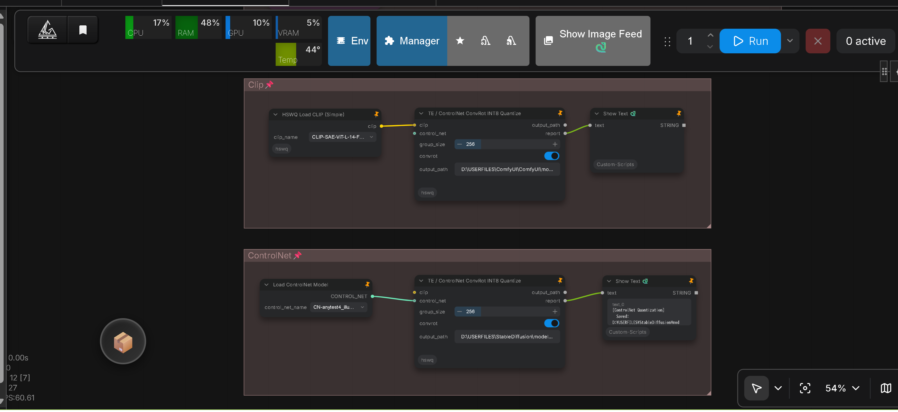
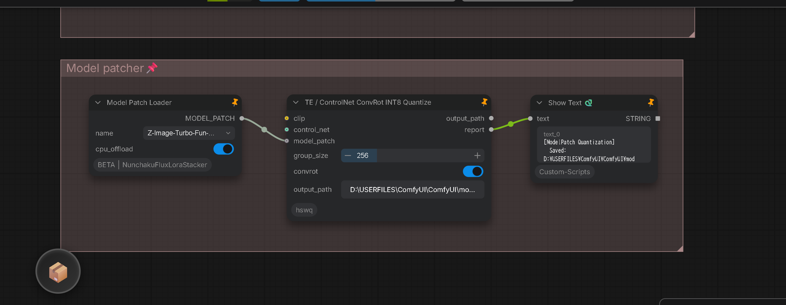
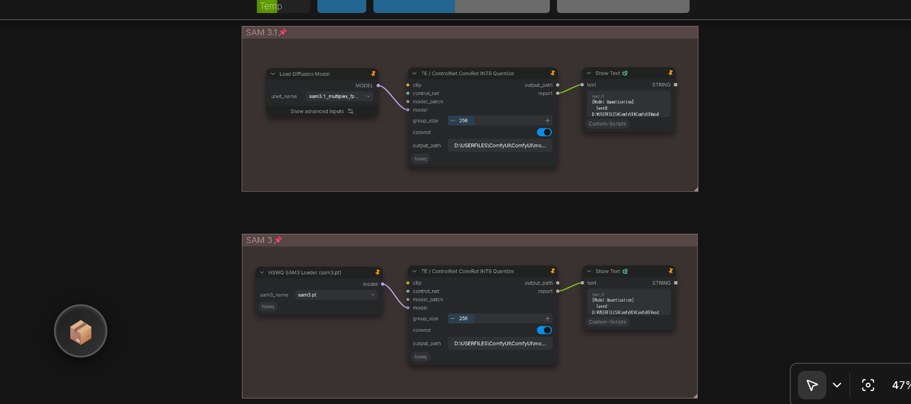

# Native ConvRot INT8 for Text Encoder, ControlNet, Model Patch and SAM 3 / SAM 3.1

> **This is a guide for the native product.** The `TE / ControlNet ConvRot INT8 Quantize`
> node and the `clip_convert/convert_clip_convrot_int8.py` script produce a **native
> ConvRot INT8** file: the 2D Linear weights are rotated and quantised to INT8, and
> nothing is held back in FP16. Every step below - the node, the CLI, the file layout,
> the load paths - describes exactly that output.
>
> **A higher-quality variant exists as an option.** The packs in
> [`HSWQ_High_Quality_Packs_ConvRot_INT8.md`](HSWQ_High_Quality_Packs_ConvRot_INT8.md)
> are built the same way but keep a measured FP16-protected layer set, and that document
> states the method and lists them. Nothing in this guide depends on it: the native file
> this guide produces is complete on its own.

Quantize loaded **ControlNet / ControlNet Union models**, **Model Patch (model patcher) ControlNets**,
**Text Encoders / CLIP**, and **Segment Anything Models (SAM 3 / SAM 3.1 Multiplex)** directly in
ComfyUI using the dedicated custom node **`TE / ControlNet ConvRot INT8 Quantize`**
(`comfyui_nodes/te_controlnet_convrot_int8_convert.py`) and the loader
**`HSWQ SAM3 Loader (sam3.pt)`** (`comfyui_nodes/sam3_pt_loader.py`), or via the standalone CLI
conversion script **`clip_convert/convert_clip_convrot_int8.py`**.

By applying orthogonal Hadamard rotations prior to per-channel INT8 quantization, this pipeline
eliminates activation outlier spikes in deep Linear layers, reducing VRAM and storage footprint
by ~50 % while preserving mask segmentation fidelity and structural guidance quality.

---

## ComfyUI Node Workflow


Quantization is performed directly in-graph from memory without requiring external CLI conversion scripts:

### Workflow Layouts

<p align="left">
  <b>1. Text Encoder & ControlNet Quantization:</b><br>
  
</p>

<p align="left">
  <b>2. Model Patch (Model Patcher) Quantization:</b><br>
  
</p>

<p align="left">
  <b>3. SAM 3 & SAM 3.1 Multiplex Quantization:</b><br>
  
</p>

---

### Sample Workflow

A ready-to-use ComfyUI workflow JSON covering all supported model types is provided in the repository:
- **[`sample workflow/native convrot int8.json`](../sample%20workflow/native%20convrot%20int8.json)**

You can load this file directly into ComfyUI (or drag-and-drop the workflow images above) to load the complete quantization graph.

---

### Pipeline Structure

The workflow consists of five specialized, parallel quantization branches:

1. **Text Encoder (CLIP / TE) Branch:**
   - **Loader:** `HSWQ Load CLIP (Simple)` (or standard `CLIPLoader` / `DualCLIPLoader` / `TripleCLIPLoader`).
   - **Quantizer:** `TE / ControlNet ConvRot INT8 Quantize` (connected via the `clip` input terminal).
   - **Monitor:** `Show Text` (Custom-Scripts) connected to `report` to display real-time quantization layer statistics and output path.

2. **ControlNet Branch:**
   - **Loader:** `Load ControlNet Model` (or `HSWQ Load ControlNet (Simple)`).
   - **Quantizer:** `TE / ControlNet ConvRot INT8 Quantize` (connected via the `control_net` input terminal).
   - **Monitor:** `Show Text` (Custom-Scripts) connected to `report` to display file size and layer breakdown.

3. **Model Patch (Model Patcher) Branch:**
   - **Loader:** `Load Model Patch` (`ModelPatchLoaderCustom` / ComfyUI `ModelPatchLoader`).
   - **Quantizer:** `TE / ControlNet ConvRot INT8 Quantize` (connected via the `model_patch` input terminal).
   - **Monitor:** `Show Text` (Custom-Scripts) connected to `report`.

4. **SAM 3.1 Branch (Multiplex Architecture):**
   - **Loader:** Standard **`UNetLoader`** (or `Load Diffusion Model`) loading `sam3.1_multiplex_fp16.safetensors` from `models/unet/` or `models/diffusion_models/`.
   - **Quantizer:** `TE / ControlNet ConvRot INT8 Quantize` (connected via the **`model`** input terminal).
   - **Monitor:** `Show Text` (Custom-Scripts) connected to `report`.

5. **SAM 3 Branch (Classic Non-Multiplex Architecture / sam3.pt):**
   - **Loader:** Dedicated **`HSWQ SAM3 Loader (sam3.pt)`** (`HSWQSAM3Loader`) loading `sam3.pt` or `sam3_fp16.safetensors`.
   - **Quantizer:** `TE / ControlNet ConvRot INT8 Quantize` (connected via the **`model`** input terminal).
   - **Monitor:** `Show Text` (Custom-Scripts) connected to `report`.

---

---

## SAM 3 vs. SAM 3.1 Architectural Differences


SAM 3 and SAM 3.1 have distinct internal network topologies and key layouts. The quantization engine incorporates explicit branching logic to ensure seamless compatibility:

| Architectural Feature | SAM 3 (`sam3.pt` / `sam3_fp16.safetensors`) | SAM 3.1 Multiplex (`sam3.1_multiplex_fp16.safetensors`) |
| :--- | :--- | :--- |
| **Model Type** | Classic Single-Object / Non-multiplex | 16-Object Multiplex Interactive Segmentation & Tracking |
| **FPN Neck Topology** | 4-Level FPN (`sam2_convs`, `vision_backbone.convs.3`) | 3-Level FPN (`propagation_convs`, `interactive_convs`) |
| **Text Projection Tensor** | $(1024 \times 512)$ Unused $\to$ **Automatically Dropped** | $(1024 \times 1024)$ Active $\to$ **Preserved & Quantized** |
| **Recommended Loader Node** | **`HSWQ SAM3 Loader (sam3.pt)`** (`HSWQSAM3Loader`) | **`UNetLoader`** / **`Load Diffusion Model`** |
| **Fused QKV In-Projection** | `.in_proj_weight` / `.in_proj_bias` split into `q_proj`, `k_proj`, `v_proj` | `.in_proj_weight` / `.in_proj_bias` split into `q_proj`, `k_proj`, `v_proj` |
| **Key Remapping** | `tracker.model.*` $\to$ `tracker.*`<br>`sam_mask_decoder.transformer.*` remapped | `tracker.model.*` $\to$ `tracker.*`<br>`sam_mask_decoder.transformer.*` remapped |
| **Quantization Input Slot** | `model` input on `TE / ControlNet ConvRot INT8 Quantize` | `model` input on `TE / ControlNet ConvRot INT8 Quantize` |
| **Quantized Output Size** | **~0.55 GB** (`sam3_convrot_int8.safetensors`) | **~0.84 - 0.89 GB** (`sam3.1_multiplex_convrot_int8.safetensors`) |

> [!IMPORTANT]
> **Key Reason for Separate Loaders:**
> - **SAM 3.1 (`sam3.1_multiplex_fp16.safetensors`)** is distributed in standard ComfyUI diffusion format and should be loaded via the ComfyUI **`UNetLoader`**.
> - **SAM 3 (`sam3.pt`)** contains raw checkpoint keys with an incompatible $(1024 \times 512)$ text projection and fused `in_proj` weights. The **`HSWQ SAM3 Loader (sam3.pt)`** node performs automatic key cleaning and structural reshaping so that the resulting `MODEL` is immediately quantizable and loadable.

---

---

## Clone the repository


```bash
git clone https://github.com/ussoewwin/Hybrid-Sensitivity-Weighted-Quantization.git
cd Hybrid-Sensitivity-Weighted-Quantization
```

---

## ComfyUI Custom Node Setup


Copy or link the repository into `ComfyUI/custom_nodes/`:

```bash
cd ComfyUI/custom_nodes
git clone https://github.com/ussoewwin/Hybrid-Sensitivity-Weighted-Quantization.git
```

---

---

## Node Parameters & Configuration


### 1. `TE / ControlNet ConvRot INT8 Quantize`

| Input / Widget | Type | Default | Description |
| :--- | :--- | :--- | :--- |
| **`clip`** | `CLIP` | Optional | Connected Text Encoder / CLIP model instance. |
| **`control_net`** | `CONTROL_NET` | Optional | Connected ControlNet or ControlNet Union model instance. |
| **`model_patch`** | `MODEL_PATCH` | Optional | Connected Model Patch (model patcher) instance, e.g. Z-Image Fun ControlNet loaded by `Load Model Patch` (`ModelPatchLoader`) from `models/model_patches/`. |
| **`model`** | `MODEL` | Optional | Connected SAM 3, SAM 3.1 Multiplex, or diffusion model instance loaded by `UNetLoader` or `HSWQ SAM3 Loader (sam3.pt)`. |
| **`group_size`** | `INT` | `256` | Preferred ConvRot Hadamard rotation group size (must be a power of 4: `4`, `16`, `64`, `256`, `1024`). |
| **`convrot`** | `BOOLEAN` | `True` | Enables orthogonal Hadamard rotation prior to INT8 scaling. When disabled, falls back to plain per-channel INT8. |
| **`output_path`** | `STRING` | `""` | Destination `.safetensors` path or directory. If left empty, saves automatically to `ComfyUI/output/` using `<model_name>_convrot_int8.safetensors`. |

> [!NOTE]
> At least one model input (`clip`, `control_net`, `model_patch`, or `model`) must be connected. You can also connect **multiple** inputs simultaneously to quantize matching models in a single queue execution.

### 2. `HSWQ SAM3 Loader (sam3.pt)`

| Input / Widget | Type | Default | Description |
| :--- | :--- | :--- | :--- |
| **`sam3_name`** | `COMBO` | First available | Target `sam3.pt` or `sam3.safetensors` file scanned across `models/checkpoints/`, `models/unet/`, `models/diffusion_models/`, and `models/sams/`. |

---

---

## Standalone CLI Conversion Script (`convert_clip_convrot_int8.py`)


For batch processing or headless environments, the CLI script `clip_convert/convert_clip_convrot_int8.py` can convert generic `.safetensors` (CLIP, LLM, ControlNet, SAM 3, SAM 3.1, UNet) directly from the command line.

> [!NOTE]
> This script produces the **native** file: every 2D Linear layer is quantized and **no FP16 protection is applied**, for every family alike. A higher-quality variant exists as an option - see *Higher-quality packs* below.

```bash
# Native baseline: SAM 3.1 Multiplex checkpoint (no FP16 protection)
python clip_convert/convert_clip_convrot_int8.py \
  --model models/unet/sam3.1_multiplex_fp16.safetensors \
  --output models/unet/sam3.1_multiplex_convrot_int8.safetensors \
  --groupsize 256

# Native baseline: generic CLIP / Text Encoder (no FP16 protection)
python clip_convert/convert_clip_convrot_int8.py \
  --model models/clip/t5xxl_fp16.safetensors \
  --output models/clip/t5xxl_convrot_int8.safetensors \
  --groupsize 256
```

### CLI Arguments

- `--model`: Path to input `.safetensors` checkpoint.
- `--output`: Path for output `.safetensors` checkpoint.
- `--no-convrot`: Disables Hadamard rotation and executes plain per-channel INT8 quantization.
- `--groupsize`: Hadamard rotation block size (must be a power of 4: `4`, `16`, `64`, `256`, `1024`, default `256`).

---

---

## Quantization Mechanics & Format


1. **State-Dict Extraction & Automatic Key Processing:**
   - The node extracts weights in memory and traces upstream loader paths.
   - For SAM architectures, automatic detection routes keys through version-specific remapping: fused `in_proj` tensors are split into `q_proj`, `k_proj`, `v_proj`, unused projection layers are pruned, and decoder transformer keys are standardized.

2. **Selective Linear Quantization:**
   - All 2D floating-point Linear weights (`.weight` with `ndim == 2`) are processed with Hadamard rotation:
     $$\mathbf{W}_{\text{rot}} = \mathbf{W} \mathbf{H}^T$$
   - Quantized to signed 8-bit integers with per-out-channel scaling:
     $$\text{scale}_i = \frac{\max_j(|W_{\text{rot},ij}|)}{127}, \quad W_{q,ij} = \text{round}\left(\frac{W_{\text{rot},ij}}{\text{scale}_i}\right)$$
   - Non-2D weights (embeddings, 1D layer norms, biases, Conv2d) are preserved unquantized in original precision (FP16/BF16/FP32) to prevent precision collapse at model boundaries.

3. **Output Checkpoint Layout:**
   ```
   <layer>.weight           int8
   <layer>.weight_scale     float32  [out_features, 1]
   <layer>.comfy_quant      uint8 JSON  {"format":"int8_tensorwise","convrot":true,"convrot_groupsize":N}
   _quantization_metadata   JSON  {"format_version":"1.0","layers":{...}}
   ```

---

---

## Loading Quantized Models in ComfyUI


### SAM 3 / SAM 3.1 Multiplex Models
Quantized SAM 3 and SAM 3.1 checkpoints stamped with `int8_tensorwise` and `comfy_quant` are **100% natively supported** by ComfyUI:
- Place the generated `sam3_convrot_int8.safetensors` or `sam3.1_multiplex_hswq_convrot_int8.safetensors` in `ComfyUI/models/unet/` or `ComfyUI/models/diffusion_models/`.
- Load them using the standard **`UNetLoader`** (or **`Load Diffusion Model`**).
- Connect directly to downstream SAM segmentation / video tracking nodes. ComfyUI automatically utilizes native INT8 Tensor Core acceleration.
- For a higher-quality SAM 3.1 pack, see *Higher-quality packs* below.

### ControlNet Models
ComfyUI does not natively support rotated INT8 tensors for ControlNet models out of the box. To load and execute these weights in ComfyUI workflows, use the dedicated loader from the **[ComfyUI-HSWQ-Loader-and-Tools](https://github.com/ussoewwin/ComfyUI-HSWQ-Loader-and-Tools)** extension:

```bash
cd ComfyUI/custom_nodes
git clone https://github.com/ussoewwin/ComfyUI-HSWQ-Loader-and-Tools.git
```

Use the **`HSWQ Load ControlNet (Simple)`** node to load the generated `.safetensors` checkpoint directly into your generation graph.

### Model Patch (model patcher) Models
Some files that are named "ControlNet" are in fact **model patches**. They live
in `ComfyUI/models/model_patches/` and are applied by dedicated apply nodes, not
by `Apply ControlNet`. **ComfyUI's own `ModelPatchLoader` does not recognise
the INT8 layout** - it builds the patch with `manual_cast`, which reads the
pack's INT8 tensors as plain weights. Use the **`HSWQ Model Patch Loader`**
(`HSWQModelPatchLoaderCustom`, `nodes/hswq_model_patch_loader.py`): it detects
the `int8_tensorwise` `comfy_quant` layers and builds the patch with
`mixed_precision_ops`, so weights stay INT8 in VRAM and the forward uses the
comfy-kitchen `int8_linear` kernel. For non-quantized checkpoints it delegates to
the ComfyUI path.

Two architectures are dispatched this way:

| the discriminator key | the class | the apply node |
| :--- | :--- | :--- |
| `control_all_x_embedder.2-1.weight` | `comfy.ldm.lumina.controlnet.ZImage_Control` | `ZImageFunControlnet` |
| `controlnet_blocks.0.y_rms.weight` | `comfy_extras.nodes_model_patch.QwenImageBlockWiseControlNet` | `QwenImageDiffsynthControlnet` |

The returned `MODEL_PATCH` plugs into the matching apply node. For the Qwen-Image
diffsynth patches the apply path is `DiffSynthCnetPatch` (per DiT block:
`img[:, :n] += model.control_block(img[:, :n], cond, i) * strength`), which is
what the per-block observable of the higher-quality build mirrors.

### Text Encoders (CLIP / TE)
Quantized Text Encoders stamped with `comfy_quant` can be loaded using standard ComfyUI `CLIPLoader` / `DualCLIPLoader` / `TripleCLIPLoader`. Llama-family encoders (Qwen3 / Qwen3-VL / Qwen3.5) self-detect the quantized layers; the OpenAI CLIP family needs the pack's `quantization_metadata` injected by the loader. For the higher-quality packs of this family, see *Higher-quality packs* below.

---

---

## Supported architectures (native)

Every model below was converted with this node or this script. The names are the sources it was
run on; the output is the `<name>_convrot_int8.safetensors` file the node writes.

| architecture | what was converted |
| :--- | :--- |
| **SAM 3.1** | `sam3.1_multiplex_fp16.safetensors` (16-object multiplex) |
| **SAM 3** | `sam3.pt`, `sam3_fp16.safetensors` (raw checkpoint keys, cleaned by the loader node) |
| **ControlNet (SD1.5)** | `control_v11f1e_sd15_tile`, `control_v11p_sd15_canny`, `control_v11f1p_sd15_depth`, `control_v11e_sd15_ip2p`, `control_v11e_sd15_shuffle`, `control_v11p_sd15_inpaint`, `control_v11p_sd15_lineart`, `control_v11p_sd15_mlsd`, `control_v11p_sd15_normalbae`, `control_v11p_sd15_openpose`, `control_v11p_sd15_scribble`, `control_v11p_sd15_seg`, `control_v11p_sd15_softedge`, `control_v11p_sd15s2_lineart_anime`, `ioclab_sd15_recolor` (lllyasviel) |
| **ControlNet (SDXL)** | `control_instant_id_sdxl`, `instantid_diffusion_pytorch_model` (InstantX), `CN-anytest4_illustrious2_A`, `CN-anytest4_illustrious2_B`, `controlnet-union-pro-max-sdxl-1.0` (xinsir) |
| **ControlNet (FLUX.1-dev)** | `FLUX.1-dev-ControlNet-Union-Pro-2.0` (Shakker Labs) |
| **ControlNet (Qwen-Image)** | `Qwen-Image-ControlNet-Inpainting` (alibaba-pai), `Qwen-Image-2512-Fun-Controlnet-Union-2602` |
| **Model patch (Z-Image-Turbo)** | `Z-Image-Turbo-Fun-Controlnet-Union-2.1-lite-2602-8steps`, `Z-Image-Turbo-Fun-Controlnet-Tile-2.1-lite-2601-8steps` |
| **Model patch (Qwen-Image diffsynth)** | `qwen_image_canny_diffsynth_controlnet`, `qwen_image_depth_diffsynth_controlnet`, `qwen_image_inpaint_diffsynth_controlnet` |
| **Text encoders** | CLIP-L, CLIP ViT-L/14 (OpenAI, SAE and GmP layouts), CLIP ViT-bigG/14, CLIP ViT-H/14, Flan-T5-XXL, SigLIP vision 384, Qwen3-4B, Qwen3-VL-4B, Qwen2.5-VL-7B, Qwen3.5-9B |

---

## Higher-quality packs (optional)

The native output is the baseline this project measures against. There is a second product: the
same conversion with an **FP16-protected layer set chosen from that checkpoint's own
measurement**, published per model, with the method and the per-model numbers stated in
[`HSWQ_High_Quality_Packs_ConvRot_INT8.md`](HSWQ_High_Quality_Packs_ConvRot_INT8.md).

Use it when you want that protection set instead of the native "quantise everything 2D" result.
It is an option, not a prerequisite: nothing above requires it, and the native file this guide
produces is a complete, loadable artifact on its own.

---

## Repository

- Source: `https://github.com/ussoewwin/Hybrid-Sensitivity-Weighted-Quantization`
- The loader extension used by the ControlNet and model-patch paths:
  `https://github.com/ussoewwin/ComfyUI-HSWQ-Loader-and-Tools`
