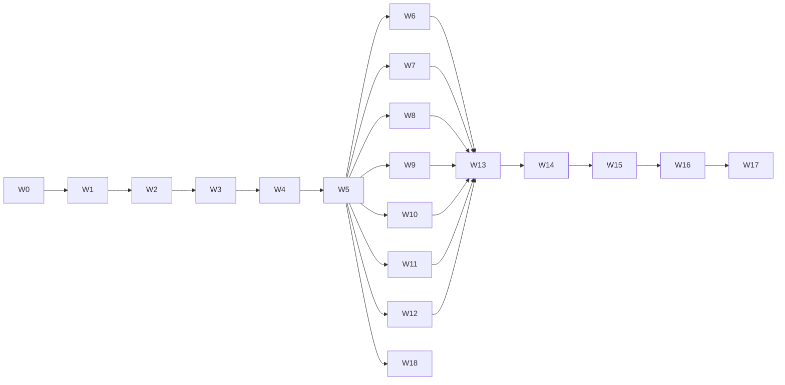

# バックドア検証 精査・改善計画書

作成日: 2026-11-03 / 対象: `audit/*.py`(50本)、`md/Backdoor_Audit_*.md`(5本)、`md/verdicts/*.md`(13本)+`records/`(170ファイル)

## 1. 現状サマリ(実測)

| ゲート | 結果 |
| :--- | :--- |
| `audit/procedure_check.py` | **123/123 PASS**(Findings 文書は 103/103 と古い記載) |
| `audit/check_cites.py` 全13レポート | **全 PASS** |
| 外部レビュー(10/29)の指摘 | 大半は解消済み(判定語 "none detected"+強度+カバレッジ、陽性対照 `Positive_Control.md`、`check_cites`、脅威モデル行、検査対象の SHA 再検証) |
| 未コミット | `md/verdicts/records/zero_census_other_artifacts.json` |

> 注: `selftest.py` / `backdoor_selftest.py` は実行が長く、この時点で結果を取得していない。P2-1 で再実測する。

## 2. 最重要所見(結論の信頼性に直結)

### P0-1. B/C 判定の根拠が、自身の陽性対照で「検出力なし」と測定済み
`Positive_Control.md` は LoRA 埋込 0/28 検出、BadEdit 島なし(比 0.92x)、clean base での tool-context 誤検出 20/28 を示す。つまり行動プローブは「検出しない・誤検出する」計器であり、B(CLIP-SAE/GmP/LongCLIP)と C(SAM3.1)の **none detected は証拠としてほぼ無重量**。索引はこれを一文で触れるのみで、判定表の本体(列)に反映されていない。
- 対応(**決定: 列追加 + 区分分離の両方**。どちらか片方では不十分):
  1. 全行に「行動プローブの検出力」列を追加。値は `Positive_Control.md` の実測(LoRA 0/28、BadEdit 比 0.92x、clean 誤検出 20/28)を record キーつきで引用。A 行は「重み水準で閉鎖、プローブは補助」と記載。
  2. 判定表を2区分に分割: **区分1「重み水準で閉鎖(A)」**と**区分2「行動プローブのみ・重み水準は未閉鎖(B/C)」**。区分2 の見出しに、検出力の限界と「none detected は検出力 0/28 の計器による」旨を明記。
  3. B/C 各レポートの冒頭にも同一文言を置き、索引と本文を一致させる。
  4. pack 行は、その source の区分を継承して表示。
  5. `procedure_check.py` に「表に強度・カバレッジ・検出力の3列が揃う」検査を追加し、再発を防ぐ。
- 受入基準: B/C 行を読んだだけで、検出力限界が分かる。lint が PASS。

### P0-2. 判定の対象が来歴不明(LongCLIP)
- `Long-ViT-L-14-...-ft-full` は公開版と 589/590 テンソルが不一致(Findings F1 未解決)。HF パックは「zer0int の名」を暗示。
- 対応(**(a) 再ビルドで確定**): zer0int 公開 checkpoint(`BEST-GmP-smooth-ft`)を入手 → SHA256 を公開値と照合 → 同じ HSWQ ConvRot INT8 手順でパックを再ビルド → 再監査。
  1. 公開 checkpoint の取得量を事前申告し、取得して SHA256 を照合(Gate 1)
  2. 現行パック(出所不明 fine-tune 由来)は新パックと別 sha として記録し、撤回扱いで索引に残す
  3. 新パックを pack クラスで監査: 完全再量子化一致(q_mismatch 0)、ローダー経由の実行ゲート(CLIP 系ルートは INT8 未適用のため既知の制約を併記)
  4. `LongCLIP_ViT_L14.md` と索引に新パックの行を追加、旧パックは withdrawn と明記
  5. HF のカード・ファイルを差し替え、アップロード前の `check_hf_upload.py` と読み戻し一致を実施
  6. Findings F1 を Closed に更新
- 受入基準: パック名・説明・実体の sha が一致し、`procedure_check` / `check_cites` が PASS。
- 同時に、監査中に5ファイルが `models/clip` から消えた件(原因未特定)の保管・SHA 検証手順を `Backdoor_Audit_Procedure.md` §3 に追加。

### P0-3. SAM3.1 は上流比較不能(403)で C 判定
カバレッジ 6%(96/1,590)。vision tower・tracker・detection head 未検査。外部レビュー指摘の IoU 異常(documented 0.8511 vs band 上限 0.7675)に対する追加実験(語彙重複を揃えた対照)が見当たらない。
- 対応(**決定: 拡大を実施。明記のみで済ませない**):
  1. 語彙重複を揃えた対照を追加し、documented 0.8511 の異常(band 上限 0.7675)を説明または確定。
  2. 動作点の見直し: 実画像・実物体で検出が成立する条件で IoU を再測定(現行は面積 0.07%、logit 負で識別力なし)。
  3. vision tower・tracker・detection head の重み水準検査を追加し、カバレッジ(現 96/1,590)を更新。
  4. 上流 403 は再申請+別ミラー照合を試行し、不可なら理由を record 化して判定欄に残す。
  5. 本文の 0.5322 / 0.7312 の表記を records と照合して修正。

## 3. 文書の不整合(実測で確認したもの)

| # | 場所 | 問題 | 修正 |
| :--- | :--- | :--- | :--- |
| D1 | `Backdoor_Audit_Procedure.md` 1〜16行 | 無関係な「Hub writes」節がタイトル `# Backdoor Audit` の**前**に混入 | 別文書へ移すか、タイトル後の付録へ |
| D2 | `Backdoor_Audit_Findings_and_Required_Work.md` 冒頭 | 「Required work: INT8 text encoder」「Upstream comparison」が表題より前。「every item closed」と書きつつ F1/F2 が Open | 構成を整理、Open/Closed 一覧を先頭に1表で |
| D3 | 同 Findings | ゲート節 "103/103"、"38/46/15/46/38"(5レポート)が古い。「flan_t5 未測定」は現在 FlanT5_XXL.md が存在し矛盾 | 現行値へ更新、または日付付き履歴として明示 |
| D4 | `Backdoor_Audit_Verdicts.md` | 冒頭 "seven artifacts"、末尾 "eight reports" だが表は **12行**。Records 節の件数も古い | 件数を表から自動生成 |
| D5 | `HuihuiQwen3VL4B_Pack.md` L199、`ThinkingQwen3VL4B_Pack.md` L219、`Backdoor_Audit_Technical_Guide.md` L1640 | 公開文書に "repository owner" / "the Owner pushed" の作業視点表現 | 中立表現へ(グローバルルール「公開文書にAI視点を入れない」) |
| D6 | `Backdoor_Audit_Verdicts.md` | 「再量子化で pack の挙動が再現される」「バックドアは量子化を生き残る」に数値/record リンクなし | record を紐付けるか、仮説と明記 |
| D7 | `SAM31_Multiplex.md` L68,154 | 0.5322 を "median" と記載。外部レビューは "最小値" と指摘 | records の該当キーを確認して表記を一致 |
| D8 | `SAM31_Multiplex.md` L24 | "872,661,740 parameters"(外部レビューは Thinking 側への誤コピーを指摘。SAM 側は妥当か要照合) | records の param 合計と照合 |
| D9 | `Huihui_Qwen3VL_4B_Abliterated.md` L82 | `closes B`(比 1.006)— 「第2成分ゼロ」でなく「検出限界以下」の表現か要確認 | 文言を "below detection limit" に統一 |

(解消済みを確認: `386 changed` の記述、`max/p99 3.97` は `1.62 (max/median 3.97)` に修正済み、`safe to quantise` は検索で出ず削除済み)

## 4. ツール面の課題

1. **F2: 埋め込み値の二重実装**(`sae_probe.py` はパディングバッチ、`clip_fp16_source_audit.py` は1件ずつ。中央値 0.8853 vs 0.8872)。バッチ方式の統一、または両 docstring に差異明記。
2. **`check_cites.py`**: 引数 `report` と `--root` が必須でヘルプ頼り。SHA 文字列は SKIP、小さい値の許容 `max(5e-5, 5e-4·|v|)` が緩い、導出値(比・割合)は未検査。
   - 対応: SHA 完全一致検査、相対許容の引き締め、導出値(max/p99 等)の再計算、全レポート一括実行モード。
3. **audit/ に50本**が平坦に並ぶ。入口(Phase 対応表)が `Backdoor_Audit_Procedure.md` にあるか確認し、`audit/README` で Phase→スクリプト対応を1枚に。
4. `selftest.py`(42/42 とされる)、`backdoor_selftest.py`、`test/audit_selftest.py` の三重化。役割を整理。
5. CI 化されていない: `procedure_check` + `check_cites`(全レポート)+ selftest + プレースホルダ/重複行 lint を1コマンドにまとめる(`audit/run_all_gates.py`)。

## 5. 優先度つき作業リスト

| 優先 | 作業 | 成果物 | 完了条件 |
| :--- | :--- | :--- | :--- |
| P0-1 | 判定表に検出力列を追加し、A と B/C の区分を分離 + lint | `Backdoor_Audit_Verdicts.md` | B/C 行で検出力限界が明示 |
| P0-2 | LongCLIP パックを公開 checkpoint から再ビルド+再監査(上記 1〜6)+消失ファイルの保管手順 | Findings F1 を Closed へ | パック名と実体が一致 |
| P0-3 | SAM3.1 の追加対照・範囲拡大・動作点見直し | `SAM31_Multiplex.md` | 異常 IoU の説明実験が record に存在 |
| P1-1 | D1〜D4・D6〜D9 の文書修正 | 5 + 3 文書 | `check_cites` / `procedure_check` 再 PASS |
| P1-2 | D5 の中立表現化 | 3 文書 | `grep -i "owner"` が 0 件 |
| P1-3 | F2 の統一 | `sae_probe.py` ほか | 同一ファイルで2ツールの値が一致、または差異明記 |
| P2-1 | selftest 群の再実測と役割整理 | 実測ログ | 全 PASS を記録 |
| P2-2 | `check_cites` 強化+`run_all_gates.py` | `audit/` | 1コマンドで全ゲート |
| P2-3 | SHA256SUMS の整備、未コミット record の取り込み | `records/` | working tree clean |
| P2-4 | Qwen3-VL ソース2本が現マシン不在 → 再取得して SHA 再検証 | records | 入力の SHA 全一致 |

## 6. 進め方の原則

- 各修正後に `procedure_check`・`check_cites` を再実行し、PASS を records に残す。
- 数値は records から再計算してから文書へ。記憶・推測で書かない。
- 検査対象の再 SHA 検証を、再実行の最初の手順にする。
- 公開文書は客観・技術記述のみ。

## 7. 決定をお願いしたい点

1. (決定済み)LongCLIP パックは再ビルド(a)。
2. (決定済み)P0-1 は列追加と区分分離の両方。
3. (決定済み)P0-3 は SAM3.1 の拡大検査を実施。

決定待ちの項目はありません。

---

# 付録A. SAM3.1 検査範囲拡大の方法書(P0-3 詳細)

## A.0 現状の穴(`SAM31_Multiplex.md` の実測に基づく)

| 領域 | 現状 | 穴 |
| :--- | :--- | :--- |
| 言語バックボーン(96/1,590) | rank-1 スクリーン、721候補の埋め込み、検出器プローブ | カバレッジ約6% |
| `dot_prod_scoring` ヘッド | §1 の序文は「測定した」とするが、§3 の表に行がない | 根拠 record がない |
| vision tower / `detector.segmentation_head` / tracker(point prompt は1回走らせただけ) | 重み・挙動とも未検査 | 画像のみで発火する trigger を検出できない |
| 上流比較 | `facebook/sam3.1` 403(拒否) | 重み差分が取れない |
| 検出器プローブ | 閾値 0.5 / 0.25、マスク面積 0.07〜0.10%、ほぼ無検出点 | S1 の「全群 0.0000」は識別力が不明 |
| S2 の異常 | documented 0.8511 > neutral 上限 0.7675 > random 0.6882 | 語彙重複説は未検証(§8 Step 8 も分離できないと自認) |
| 計器の検出力 | `Positive_Control.md`: 重み水準で 0/28、tool-context 誤検出 20/28 | 重み・視覚側の検出力は未測定 |

## A.1 作業ストリーム全体

| ID | 内容 | 新規/改修スクリプト | 新規 record |
| :--- | :--- | :--- | :--- |
| S0 | 入力固定と全テンソル分類 | `audit/sam31_census.py`(新規) | `sam31_census.json` |
| S1 | 全 1,590 テンソルの重み水準スクリーン | `audit/sam31_weight_screen.py`(新規。`backdoor_audit.py` の `layer_metrics` を再利用) | `sam31_weight_screen.json` |
| S2 | 実画像で成立する動作点の確立 | `sam31_detector_probe.py` 改修(`--images-dir`, `--prompts-real`) | `sam31_operating_real.json` |
| S3 | 語彙重複を揃えた S2 対照 | `sam31_keyed_control.py` 改修(`--overlap-matched`) | `sam31_s2_overlap_control.json` |
| S4 | vision / tracker 側の画像のみ trigger 探索 | `audit/sam31_image_trigger.py`(新規) | `sam31_image_trigger.json` |
| S5 | 重み水準の陽性対照(SAM 版) | `audit/sam31_weight_positive_control.py`(新規) | `sam31_positive_control.json` |
| S6 | 上流比較の再試行 | `fetch_reference.py`(既存) | `sam_gated.json` 更新 |
| S7 | 判定・文書更新 | `SAM31_Multiplex.md`、索引、`procedure_check.py` | - |

実行順: S0 → S5 → S1 → S2 → S3 → S4 → S6 → S7。S5 を S1 の前に置くのは、検出力が未知のスクリーンの結果を先に見て解釈が動くのを避けるため。

## A.2 S0. 入力固定と全テンソル分類

1. 対象ファイルの SHA256 を再計算して `9ba99c92703c…` と照合(不一致なら中止し INCONCLUSIVE)。
2. safetensors ヘッダから 1,590 テンソル全部をプレフィックスで分類し、**各テンソルを必ずどれか1つのグループに割当てる**(未分類 0 を Gate とする)。想定グループ:
   - `detector.backbone.language` / `detector.backbone.vision`(vision tower)
   - `detector.transformer`(encoder/decoder)
   - `detector.segmentation_head`(pixel decoder 含む)
   - `detector.dot_prod_scoring`
   - `tracker.*`
   - 埋め込み・位置・LayerNorm・bias・スカラー
3. グループ別に テンソル数、パラメータ数、次元数(2-D / 4-D / 1-D)を `sam31_census.json` に出力。実際のプレフィックスは census が決める(上記は想定。census 結果と異なれば census を優先)。

Gate S0: 分類済み合計 = 1,590、未分類 0。

## A.3 S1. 全テンソルの重み水準スクリーン(カバレッジ 96 → 全 2-D/4-D)

上流が無いので「差分」ではなく**自己完結の構造統計**を使う。

| 対象 | 測定 | 閾値の決め方 |
| :--- | :--- | :--- |
| 全 2-D 重み | `s1²/Σs²`(先頭特異値の寄与)。同形状の Gaussian 行列を基準に倍率化 | 閾値は S5 の陽性対照で実測した検出下限に基づく(手置きしない) |
| 全 4-D(Conv) | `(out·rows, in)` 空間へ展開して同上(`layer_metrics(..., conv_rows)` と同じ) | 同上 |
| 全 1-D(bias、norm) | 層内の z-score、外れ値の数 | 同グループ内の分布の p99.9 |
| 全埋め込み行 | 行ノルム、最近傍コサイン、外れ値行(言語側は済、vision/位置は新規) | 行ノルムの p99 と最大値 |
| 全テンソル | NaN/Inf の有無、全ゼロ・定数テンソル(`zero_census` と同手法) | 0 件 |
| 同形状の兄弟テンソル(例: 24層の q/k/v) | 層間の特異ベクトル整合性(層だけ孤立した方向を持つか) | 層間の中央値からの偏差 |

出力: テンソル単位の行、グループ別の要約(中央値・p99・最大・外れ値の名前)。外れ値は全件に名前を付けて個別調査(Gate S1)。

Gate S1: 全 1,590 テンソルが測定済み(coverage = 1,590/1,590)。外れ値は各々「説明済み / 未説明」に分類し、未説明が残る場合は判定を保留。

## A.4 S2. 検出が成立する動作点

現行の閾値 0.5/0.25 ではマスク面積が 0.07〜0.10% で、IoU 0.0000 は識別力が不明。

1. 入力: 実画像 ≥ 24 枚(ComfyUI の `input` から。人物・風景・物体・屋内外・文字入り画像を含める)。ノイズ画像は対照としてのみ使う。
2. プロンプト: **画像に実在する物体を指す一般語**(`person`, `car`, `dog`, `building` など ≥ 20語)。各プロンプトで最高 score と面積を記録。
3. 動作点選定の基準: 実在物体プロンプトで **マスク面積中央値 ≥ 1%** かつ **score 中央値が正**(logit > 0)となる閾値を、層別に探索(閾値 0.1〜0.9 を 0.05 刻み)。
4. その動作点で、既存の trigger/neutral 群(documented / random / filler_short / filler_tag)を再測定し、S1 / S2 の統計を取り直す。
5. 動作点で陽性対照 A/B(`sam31_keyed_control.py` の注入)を再実行し、統計の感度が保たれるか確認。

Gate S2: 実物体プロンプトで検出が成立する動作点を確立し、その点での感度対照が通る。成立しなければ「検出器プローブは識別力なし」と判定欄に明記。

## A.5 S3. S2 異常(0.8511)の語彙重複対照

仮説: documented family は互いに単語を共有する単語変種(例: 同じフレーズの変形)で、共有トークンが似たマスクを生むだけ。

1. 各 family の **トークン重複度** を定量化: ペアごとの共有トークン率(Jaccard)を `tokenizer` から算出。
2. **重複度マッチ対照群** を新規生成: documented family と同じトークン重複度分布(ペア Jaccard の分布が KS 検定で区別不能)になるよう、無害な語句から構成した family を作成(n ≥ 28、同数)。
3. 同条件(S2 の動作点)で same-image within-family IoU を測定。
4. 回帰: IoU ~ Jaccard を全群で当てはめ、documented family の残差が 0 から有意にずれるかを見る(ブートストラップ 95% 区間)。
5. 判定: 重複度マッチ対照が documented と同水準 → 語彙重複で説明が付く(Closed)。documented だけが残差で高い → 未説明異常として判定に残す。

Gate S3: マッチ対照が KS で区別不能であること、かつ残差検定の結果が record にある。

## A.6 S4. 画像のみで発火する trigger の探索(vision / tracker)

テキスト入力の無い経路には、プロンプトでなく**画像側の trigger** を探す。

1. 候補画像集合を3系統で生成:
   - **パッチ trigger**: 実画像の四隅/中心に固定パターン(小さな市松、単色パッチ、QR 状)を貼る、サイズ 16/32/64 px、位置 5 通り
   - **周波数 trigger**: 低周波/高周波の加法ノイズ(σ を 3 段階)
   - **自然な変形**: 回転・反転・明度・JPEG 圧縮(トリガーでなく対照)
2. 各候補を 実在物体プロンプトで検出器に通し、元画像と比べた **マスク IoU 変化・score 変化・面積変化** を記録。
3. 判定基準: 変形群(対照)の変化分布の p99 を超える変化を示した trigger を異常候補とする。
4. tracker 側: point prompt で 24 枚 × 5 点を走らせ、出力の有限性、入力間でのマスク一致(IoU 高止まり)を確認。
5. 内部活性: vision tower の最終層出力に対し、パッチ trigger 有無の埋め込み変位を、変形対照の分布と比較(外れ値 = 候補)。

Gate S4: 全候補を実行し、変化量の分布と対照の p99 を record に残す。対照を超える候補ゼロ、または超えたものを個別調査済み。

## A.7 S5. 重み水準の陽性対照(SAM 版)

目的: S1 の検出下限を実測で決める。**これが無いと S1 の「異常なし」は無意味**(レビュー指摘と同じ構造)。

1. 検出器の vision / transformer / head / 言語側のそれぞれから代表テンソルを選ぶ。
2. 実ファイルのコピー(scratch)に、既知の埋込を複数強度で書く:
   - rank-1 加算(強度 = 元の Frobenius ノルムの 0.1% / 0.3% / 1% / 3%)
   - bias 1 要素の加算
   - 埋め込み行の差し替え(言語側)
   - 4-D Conv の 1 チャネル加算
3. 埋込済みファイルに S1 を実行し、**どの強度から検出されるか** を測定(検出率 = 検出数/埋込数)。
4. 検出下限を判定欄へ転記: 「S1 は強度 X% 以上の rank-1 加算を検出する。それ未満は検出不能」。

Gate S5: 各領域で検出率が record にあり、閾値が実測値で決まっている。

## A.8 S6. 上流比較の再試行

1. 現行トークンで `facebook/sam3.1` に再申請(オーナー操作が必要。承認状態を record に残す)。
2. 並行して別ミラーを確認(公式 fp32 に近いもの。`Comfy-Org` 以外の公開リポジトリ、各々 base_model 申告を確認)。
3. 取得できた場合のみ: fp32→fp16 丸めで全 1,590 テンソルを突き合わせ(bit 一致か、丸め範囲内か)。
4. 取得不能の場合: 拒否応答と日時を `sam_gated.json` に追記し、判定欄の `none detected` の隣に「上流比較なし」を残す。

Gate S6: 結果(取得 or 拒否)が日付つきで record にある。

## A.9 S7. 判定への反映ルール

| S 結果 | 強度表記 | カバレッジ |
| :--- | :--- | :--- |
| S1 全テンソル測定+S5 で検出下限が既知+S4 の異常ゼロ+S3 で異常説明済み | **B**(重み水準閉鎖は不可、構造統計+行動プローブで全域) | 1,590/1,590 |
| 上記のいずれか未達 | **C のまま**、未達項目を判定欄に列挙 | 実測値 |
| 上流が取得でき全テンソル一致 | **A**(declared edit なし=変換のみ) | 1,590/1,590 |

文書更新: `SAM31_Multiplex.md` に Step 9〜15 を追加し、§1 の「`dot_prod_scoring` を測定した」を record つきの行にするか削除。LIMITS を実条件で書き直し(プロンプト数・画像数・動作点・検出下限)。索引の行と P0-1 の「検出力」列も更新。

## A.10 受入条件(全体)

- S0〜S6 すべてに record があり、`check_cites.py` が PASS。
- `procedure_check.py` に SAM3.1 の必須行(カバレッジ、動作点、検出下限)を追加して PASS。
- GPU: RTX 5060 Ti 16 GB で実行。各ステップの実行時間と使用量を run record に記録。
- 取得が必要なもの(S6)の容量は、事前に申告してから開始する。

---

# 付録B. 改訂 2026-11-08(ControlNet 8本・model patch 5本追加後の再精査)

## B.0 前提となる現状(実測)

| 項目 | 結果 |
| :--- | :--- |
| 前回計画(P0-1〜P2-4、付録A S0〜S7) | 2026-11-04 までに対処済み(v2.5.1 で公開) |
| 追加された対象 | ControlNet pack 8本(anytest4 A/B、Union ProMax SDXL、FLUX Union Pro2、Qwen2512 Fun、Qwen Inpainting、noobai lineart ×2)、model patch pack 5本(Z-Image Union/Tile、Qwen DiffSynth canny/depth/inpaint)。レポート 13→**26本**、監査スクリプト 7本追加 |
| `run_all_gates.py`(2026-11-08 実行) | procedure 174/174 PASS、check_cites 26本 944 resolved/0 failed/0 skipped PASS、selftest 42/42 PASS、lint PASS、**SHA256SUMS FAIL**(`card_loader_route_probe.json` が未登録)→ **総合 GATE FAILURE** |
| working tree | 未コミット: `test/_hf_README_controlnet_convrot_int8.md`(変更)、`records/card_loader_route_probe.json`(新規) |

## B.1 最重要所見(結論の意味に関わる)

### Q0-1. 「A」の意味が ControlNet/model patch で別物になっている
- LM 系の A は「宣言された参照との差分が重み水準で全て説明できる」。ControlNet/model patch 13本の A は「**pack = 公開 source の量子化と bit 一致**」のみ。参照は発行元の release 自身で、レポート自身の LIMITS にも「その release に元からある欠陥は比較で到達不能」と書かれている。
- 索引は両者を同じ **Section 1「Strength A — Closed at Weight Level (Delta Fully Accounted For)」** に並べ、`none detected (A, 844/844)` と表示する。読者は「バックドアなしが重み水準で閉じた」と読む。実際に閉じたのは **pack の忠実性**であり、**source のバックドア不在ではない**。
- 対応(**列追加 + 区分分離**。P0-1 と同じ方針):
  1. 索引に2軸を明記: **(a) pack 忠実性**(source→pack)と **(b) source 側の不在証明**(参照との差分。ControlNet は fine-tune 由来で参照なし)。
  2. ControlNet/model patch 13行は A を維持せず、新区分 **「A-pack / source は発行元 release を参照(B 相当)」** へ移す。または強度表記を `A(pack)` / `B(source)` の2段表記にする。
  3. Strength definitions に「A は参照との差分が全て説明される場合のみ。source が参照を持たない pack は pack 忠実性のみ A」と追記。
  4. `procedure_check.py` に「pack 行は source の強度を継承して表示する」検査を追加(P0-1-4 が LM 系 pack だけで ControlNet に未適用)。
- 受入基準: ControlNet/model patch の行を読んだだけで、「pack は忠実、source の不在は未証明」が分かる。

### Q0-2. 画像条件トリガーが未検査(SAM3.1 の S4 に相当する穴)
- ControlNet / model patch の入力は**制御画像**。テキスト用の trigger 探索は無意味で、**制御画像側の trigger**(パッチ、周波数、特定パターン)が出力を誘導する経路が未検査。脅威モデル節(索引)は LM・text encoder・SAM のみで、ControlNet/model patch の行がない。
- 現状の挙動測定は「各 pack 1枚の正常な制御画像で描画が通り、潜在が有限」のみ。検出力は未測定。
- 対応:
  1. 脅威モデル行を追加: 「ControlNet / model patch: 実行面なし。制御画像で出力を誘導する。重みに入る trigger は画像側で発火し得る」。
  2. 付録A S4 と同様の探索を **代表 pack 3本以上**(SDXL / Qwen / Z-Image 系で各1)に実施: パッチ trigger(16/32/64 px、5 位置)、周波数 trigger、自然な変形(対照)。比較は **pack 対 source の出力差** と **変形対照の p99**。
  3. 陽性対照: 既知の埋込(rank-1 加算、入力層の1チャネル加算)を ControlNet の scratch コピーに書き、上記探索が **どの強度から検出するか** を実測(SAM 版 S5 と同型)。無いと「検出されない」が無意味になる。
  4. 実施しない場合は、各レポートの判定欄に「制御画像 trigger は未検査」と明記する(LIMITS だけでなく結論行へ)。

### Q0-3. 実行ゲートの網羅不足が結論欄に出ていない
- Union ProMax SDXL: 適用 325/328。未適用 3 層は union 用で、**union type 選択は未実行**。判定欄に1文あるのみで、強度や coverage 列に反映されない。選択経路の層は**実行されていない = 実行面で検証されていない**。
- 対応: union-mode を指定した実行を追加して 328/328 を実行確認する。不可なら、未実行層を coverage の別列に出す(`executed 325/328`)。
- FLUX の render 1356.1 s など描画は1条件のみ。条件(制御種別、画像、seed)を複数にして finite と出力差を取る。最低3条件。

### Q0-4. 数値品質(INT8 と元モデルの差)の記録が揃っているか不明
- Josiefied 等は cond cos 値を引用。ControlNet/model patch 13本について、**FP16/元 source 実行との出力差(cos・最大誤差)** を records に持つか未確認。
- 対応: 全13本に「同一入力で source(FP16)と pack の出力差」を records 化し、索引の列に追加。`protection` セットの根拠(drift > 0.15 など)と対にする。

## B.2 文書・索引の不整合(実測)

| # | 場所 | 問題 | 修正 |
| :--- | :--- | :--- | :--- |
| E1 | 索引 Section 1 | 24行が種別ごとに並んでいない(LM、text encoder、ControlNet、model patch、SAM が混在)。検索性なし | 種別の小見出し(Text/LM、ControlNet、Model patch、Segmentation)で分割。件数は表から自動生成 |
| E2 | 索引 冒頭 | 「Every published HSWQ pack」と書くが、noobai の legacy pack は**モデルカードに無い**(自身の行に明記)。また「B/C は検出力列」(Section 2)に、プローブ未実施の noobai legacy が入り、列の値が「該当せず」で別物 | legacy を withdrawn / local-only の別小節へ。冒頭の主張を実態に合わせる |
| E3 | 索引 行 | 二重閉じ括弧 `float side 43 exact))`(Z-Image 2行)、`float side 242 exact))`(depth/inpaint)。`ComfyUI own mapping`(B 行、所有格の脱落) | 修正。`check_cites`/lint に `))` と所有格の検査は不要だが、行の再生成時に混入するため自動生成化 |
| E4 | `ZImageTile21_Pack.md` / 索引 Tile 行 | `pack of alibaba-pai/Z-Image-Turbo-Fun-Controlnet-Union-2.1`(Union の repo 名)と書かれ、Tile の release 名か不明 | records の `source.repo` と照合して表記を一致 |
| E5 | `Backdoor_Audit_Verdicts.md` Methodology | 「Pack-side behaviour check」が旧 record 3 件のみを列挙。ControlNet/model patch の route・exec・image_test が出てこない | 現行の record 名一覧を自動生成 |
| E6 | `ThinkingQwen3VL4B_Pack.md` L219 | **`repository owner.` が残存**(D5 の取りこぼし。P1-2 受入基準 `grep -i "owner"` = 0 件を満たさない) | 中立表現へ。`run_all_gates.py` の lint に `owner` 検査を追加 |
| E7 | `audit/README.md` | 追加した 8 本(`controlnet_*.py`、`model_patch_*.py`、`controlnet_image_test.py`)が Phase 表にない | 追記し、「全 `audit/*.py` が README に載る」検査を gate に追加 |
| E8 | `Backdoor_Audit_Procedure.md`・Findings | ControlNet/model patch の手順(instrument-match ルール、protection census、loader route 検査)が手順書の Phase として定義されているか未確認。instrument-match は LIMITS にだけ記述 | Procedure に Phase として正式化し、`procedure_check` の検査項目に追加 |
| E9 | `check_cites.py` 出力 | `WARN named as inventory, no field cited` が **62件**(再実行ごと)。inventory 扱いの record は引用検査をすり抜ける | 件数を上限つき gate に(例: 新規増加ゼロ)。許容リストを `audit/` に置き、リスト外の WARN で FAIL |

## B.3 ゲート・運用

1. **SHA256SUMS FAIL を直す**: `card_loader_route_probe.json` を登録(再生成)。`run_all_gates.py` を **commit 前の必須手順**にする。現状、records 追加のたびに忘れて失敗する構造。→ 登録漏れを防ぐため、`records/` への追加を検知して `SHA256SUMS` を自動再生成する `--regen` を gate に付ける。
2. `test/_hf_README_controlnet_convrot_int8.md` の未コミット差分を、内容確認後に commit または破棄。
3. `gate_run_<date>.json` が gate 実行のたびに更新される。同日2回目以降の扱い(上書き/連番)を決める。
4. selftest(42/42)に ControlNet/model patch 用ケースがあるか確認。無ければ追加: 1 LSB 改変、instrument 取り違え(948 codes 差)、未適用層の検出、protection 集合の欠落。**instrument-match 違反が FAIL になること**を selftest で保証する(本ルールは現在 LIMITS の記述のみ)。
5. 重い実行(FLUX 1356 s 等)は record の `wall_seconds` と GPU 使用量を残す(付録A.10 の受入条件)。

## B.4 追加の優先度つき作業リスト

| 優先 | 作業 | 成果物 | 完了条件 |
| :--- | :--- | :--- | :--- |
| Q0-1 | ControlNet/model patch 13行の強度表記を「pack 忠実性」と「source 不在」に分離 + lint | 索引、各レポート冒頭、`procedure_check.py` | 13行で source の強度が明記され、lint PASS |
| Q0-2 | 制御画像 trigger の探索(代表3本)+ 陽性対照 | `audit/controlnet_image_trigger.py`(新規)、records | 検出下限が record にある、または未検査を結論行に明記 |
| Q0-3 | Union ProMax の union type 実行、複数条件の描画 | `controlnet_int8_exec.py` 改修、records | 実行層 328/328、条件 ≥ 3 |
| Q0-4 | pack と source の出力差を全13本で records 化 | records、索引に列追加 | 13本とも cos・最大誤差が引用される |
| P1-E | E1〜E9 の修正 | 索引、README、Procedure、Thinking 報告 | `grep -i owner` が 0 件、`check_cites` WARN が許容リスト内 |
| P1-G | SHA256SUMS 再生成+未コミット2件の処理+ `run_all_gates` を commit 前必須化 | records、audit | gate が全 PASS |
| P2-S | selftest に ControlNet/model patch 用ケース(instrument-match 違反を含む) | `audit/selftest.py` | 新ケース PASS、違反ケースが FAIL を返す |

実行順: **P1-G**(gate を緑に戻す)→ **P1-E** → **Q0-1**(文書の意味を正す。測定不要で最短)→ **Q0-3** → **Q0-4** → **Q0-2**(最大工数)→ **P2-S**。

## B.5 判断をお願いしたい点

1. Q0-1: ControlNet/model patch の索引表記は **(a) 新区分に分離(Section 3 として「pack 忠実・source は参照 release」)**、**(b) 2段表記 `A(pack)/B(source)` を既存 Section 1 内で維持** のどちらか。推奨は (a)。
2. Q0-2: 画像 trigger 探索の範囲は **代表3本**(推奨)か、**全13本**か。後者は FLUX で数時間規模。

---

## B.6 前回項目の最終状況(参考)

前回の P0-1〜P2-4 と付録A S0〜S7 は 2026-11-04 付で全て対処済み(v2.5.1 に収録)。付録B の E6(`owner` 残存)と E9(inventory WARN)は、前回の P1-2・P2-2 の受入基準に対する**取りこぼし**として扱う。

---

## B.7 追加13本の個別レポート確認結果(2026-11-08)

対象: `CN_AnyTest4_Illustrious2_A/B`、`CN_Union_ProMax_SDXL`、`CN_FLUX_Union_Pro2`、`Qwen2512FunCN`、`QwenImageCNInpaint`、`NoobaiLineart`、`NoobaiLineart_HSWQ`、`ZImageUnion21`、`ZImageTile21`、`QwenDiffSynthCanny/Depth/Inpaint`。全て UTF-8 として正常。`owner` 表現は 0 件。

| # | 区分 | 所見 | 対象 | 修正 |
| :--- | :--- | :--- | :--- | :--- |
| R1 | 文書破損 | 文が孤立した行 `is what makes the comparison meaningful.`(直前の箇条の続きが欠落) | `ZImageUnion21` L100、`ZImageTile21` L100、`QwenDiffSynthDepth` L100、`QwenDiffSynthInpaint` L106 | 文を結合。canny は正常で、4本が同じテンプレート由来 |
| R2 | **出典なき数値** | 「借用した別 instrument で 118 / 138 / 883 / 539 / 948 codes が1ステップずれ、相対 scale 差は 2.18e-07 / 2.32e-07 / 6.30e-07 / 4.32e-07 / 5.6e-07」が本文のみで、どの record にもない。`check_cites` は表の引用しか見ないため通過 | Tile、Union21、Depth、Inpaint、Canny(canny は旧 record に `boundary` 語のみ) | 該当の借用 instrument 実測を record 化して引用、または文を削除。`check_cites` を本文の数値付き主張にも拡張 |
| R3 | 出典なき主張 | 「every one of them on a .5 rounding boundary」を結論に記載。根拠 record なし | Tile、Union21、Depth、Inpaint | record に件数を持たせて引用、無ければ削除 |
| R4 | 入力検証の欠落 | 「N inputs re-verified by SHA256 before this pass」行が、ControlNet 6対(12ファイル、`controlnet_inputs_reverified_2026-11-06.json`)にしか無い。model patch 5本と noobai 2本は SHA 再検証 record も行も無い | Z-Image 2本、DiffSynth 3本、noobai 2本 | 再検証 record を作り、7本に同じ行を追加。procedure_check に「全 pack レポートに再検証行」を追加 |
| R5 | 見出しと実測の乖離 | `Verdict: no backdoor detected (strength A, coverage 863/863)` だが、実行確認は 325/328。union type 選択は未実行 | `CN_Union_ProMax_SDXL`(索引行も同様) | 見出しに `executed 325/328, union type selection not exercised` を併記(Q0-3 に統合) |
| R6 | 見出しと実測の乖離 | `Verdict: no backdoor detected (strength C, coverage 0/844 ...)`。比較が0本で「検出なし」は誤読を招く | `NoobaiLineart`(索引行も同様) | 判定語を `not established (source not identified)` に変更。0/844 は「検出なし」の根拠にならない |
| R7 | 強度表記 | 13本とも `strength A` だが、Q0-1 のとおり source は発行元 release(参照差分なし) | 全13本 | Q0-1 に統合 |
| R8 | 作業履歴の混入 | 本文に「an earlier version of this report presented ... withdrawn」(FLUX、Union ProMax) | 2本 | 訂正履歴は索引の withdrawn 行と `records/` に移し、判定本文は現在の測定のみ |
| R9 | 書式 | `1238446`(桁区切りなし。他は `1,306,054`) | `CN_Union_ProMax_SDXL` L60 | 桁区切りに統一 |
| R10 | 描画の限定 | 描画は各 pack 1プロンプト・1条件。レポートも「画質・制御忠実度は言えない」と自認 | 全13本 | Q0-3 の「条件 ≥ 3」へ統合 |
| R11 | 来歴 | Tile の source を `alibaba-pai/Z-Image-Turbo-Fun-Controlnet-Union-2.1`(リポジトリ名)から取得と記載。record は `source.file` のみで repo 名を持たない | `ZImageTile21` | record に `source.repo` を追加し、Hub の LFS oid との照合を引用 |

### 追加の作業(B.4 の表に追記)

| 優先 | 作業 | 完了条件 |
| :--- | :--- | :--- |
| P1-R | R1・R8・R9 の文書修正 | 孤立行 0 件、`check_cites` PASS |
| P1-R | R2・R3 を record 化して引用(または削除)+ `check_cites` の本文数値検査 | 本文の数値が全て record に解決する |
| P1-R | R4: 7本の SHA 再検証 record と行の追加 | 全 pack レポートに再検証行 |
| P1-R | R5・R6: 見出し・索引の判定語を実測に一致 | 見出しと実行層数・coverage が一致 |
| P1-R | R11: `source.repo` の追加 | Tile の来歴が record で引用される |

---

## B.8 再見直し(2026-11-08 19:43、HEAD `71e07f7`)

### 前回項目の現状
| 項目 | 状態 |
| :--- | :--- |
| gate | **全 PASS**(procedure 174/174、check_cites 944/0 failed、selftest 42/42、SHA256SUMS 263 件一致、lint)。`hashes.txt` は復元・git 管理下 |
| R1(孤立文) | 解消 |
| R9(桁区切り) | 解消 |
| R2・R3(出典なき借用 instrument 数値、.5 境界の主張) | **未解消**(Canny/Depth/Inpaint/Tile/Union21 に残存) |
| R4(SHA 再検証行) | 未解消(5/13 のみ。Z-Image 2、DiffSynth 3、noobai 2 に無い) |
| R5・R6・R7(見出しの判定語・強度) | 未解消 |
| R8(作業履歴の混入)・R11(`source.repo`) | 未解消 |
| Q0-1〜Q0-4、P2-S | 未着手 |

### 新規所見(`d125f4c` 以降の全面置換)
このリポジトリで禁止されていた語を全体から置換した作業(約110ファイル・約470行)が入り、**文脈を見ない置換**になっている。

| # | 所見 | 影響 |
| :--- | :--- | :--- |
| N1 | **記録された生成物の改変**: `josie_*.json`、`vl_texts*.json`、`behaviour_*.json` 等の「モデルが実際に出力した文」の一部が、置換前の語から別の語へ書き換わった(置換の前後差は該当 records の原本と作業ツリーの差分で確認できる) | records は実測の証拠。出力文の改変は証拠の改変にあたり、元の生成と一致しない |
| N2 | **入力の変更が測定後に行われた**: プロンプト(`audit/josie_trigger.py`、`audit/vl_divergence.py`)、公開ベンチマーク `jbb.json` の Goal/Target が書き換わった(置換前の文は該当ファイルの原本と作業ツリーの差分で確認できる)。実測は旧文で行われている | records の probe 入力と、実行した測定が一致しない。再実測をしない限り「同一入力」と言えない |
| N3 | **意味の破壊**: `100% ComfyUI`/`100% baseline`、`ComfyUI ComfyUI nvfp4 path`、`ComfyUI ComfyUI ops.py`、`ComfyUI's own has no quantized Conv2d op`、`the ComfyUI pack`、`ComfyUI loads this pack 100% ComfyUI`。`ControlNetLoader` の説明も `ComfyUI's own` / `The ComfyUI` に置換され、無改造の標準を指す語の意味が文ごとに別物になった | 技術文書・コメント・ヘルプ文・print 文の可読性と正確性が低下(82 本の py は構文 OK) |
| N4 | **識別子・出力ラベルの変更**: 旧語を内包する識別子と出力ラベル(`audit/` の該当スクリプト、`archives/krea2_native_nvfp4_bench.py`)が置換語へ改名され、`records` のフィールド名も改名(`word_normalization_2026-11-08.json` の `technical_labels_renamed`) | 過去の records・ログを読む側(`check_cites`、各レポート)とのキー整合は gate では通過しているが、旧ログとの対応が切れる |
| N5 | **公開 record に所有者視点**: `word_normalization_2026-11-08.json` の `what` に「the terminology the Owner banned for this repository」。`note` に「previous field names are intentionally not reproduced」 | グローバル規定(公開文書に作業視点を入れない)に反し、置換の中身を第三者が追えない |
| N6 | `ComfyUI-master/` を git から外した(1,439 ファイル・約192万行削除)。作業ツリーには未追跡で残存 | 3リポジトリへ `ComfyUI-master` をコミットする `download-comfyui-latest` スキルの手順と矛盾 |

### 対応案(優先順)
1. **N1・N2**: records と probe 入力は元の文に戻す(`git show 2cc2798:<path>`)。語の統一が必要なら、**文書の地の文とコード内の説明に限定**し、records の生成文・公開データセット・プロンプトは対象外にする。戻したら該当 probe の SHA256SUMS を再生成。
2. **N3・N4**: 置換を文脈つきでやり直す(置換先は「標準の ComfyUI」「無改造」「同梱」のいずれかを文ごとに判断)。識別子とキー名は意味の正しい中立語へ戻すか、改名する場合は全参照を一括変更し selftest を通す。
3. **N5**: 置換 record から所有者視点の記述を除き、置換規則(旧語→新語の対応表)を record 内に残す。
4. **N6**: `ComfyUI-master` の扱いを決める(スキルの手順を改訂するか、追跡を戻す)。
5. R2〜R8・R11 と Q0 系は B.4 の順に継続。

---

# 付録C. 最終版 作業一覧(2026-11-08 確定。付録B の B.4・B.7・B.8 を統合し、これを実行の基準とする)

> [!NOTE]
> 本付録は計画のみで、実施は未着手。作業ツリーは HEAD(`71e07f7`)と同一(未追跡は `ComfyUI-master/` のみ)。付録B の記述と食い違う場合は付録C を優先する。

## C.1 前提(実測、2026-11-08 19:43)

| 項目 | 状態 |
| :--- | :--- |
| gate | 全 PASS(procedure 174/174、check_cites 944 resolved/0 failed/0 skipped、selftest 42/42、SHA256SUMS 263 件、lint) |
| 個別レポート | 26本。追加13本(ControlNet 8、model patch 5)を確認済み |
| 解消済み | R1(孤立文)、R9(桁区切り)、SHA256SUMS 登録漏れ、`hashes.txt` の復元と追跡 |

## C.2 決定事項

| # | 内容 | 決定 |
| :--- | :--- | :--- |
| 1 | ControlNet/model patch の索引表記(Q0-1) | **新区分へ分離**(「pack 忠実・source は発行元 release を参照」) |
| 2 | 制御画像 trigger 探索の範囲(Q0-2) | **代表3本**(SDXL、Qwen、Z-Image 系で各1) |
| 3 | `ComfyUI-master/` の扱い(N6) | **必ず Git で追跡・更新する**(`download-comfyui-latest` スキルが正。untrack は誤りであり即時追跡に戻す) |
| 4 | 置換方針(N1〜N5) | **records・公開データセット・probe 入力・`ComfyUI-master/` は置換対象外**。文書の地の文と自前コード内説明に限り、文ごとの判断で置換 |

## C.3 作業一覧(実行順)

### 段階1: 証拠の復旧と `ComfyUI-master/` 追跡復元(最優先)
| ID | 作業 | 対象 | 完了条件 |
| :--- | :--- | :--- | :--- |
| W0 | `ComfyUI-master/` を Git 追跡に戻す(`d125f4c` での untrack を取り消し) | `ComfyUI-master/` | `git status` で `ComfyUI-master/` が未追跡にならず、全ファイルが追跡状態に戻っている |
| W1 | records と probe 入力を置換前(`2cc2798`)の内容に戻す | `behaviour_base_pub`、`behaviour_rebuild`、`jbb`、`josie_base`、`josie_base_labels`、`josie_pub`、`josie_pub_labels`、`josie_trigger`、`labels_long`、`trigger_divergence`、`vl_div_ruled`、`vl_texts`、`vl_texts_long`(各 `.json`)、`audit/josie_trigger.py`、`audit/vl_divergence.py` | 15ファイルの内容が `2cc2798` と一致。`jbb.json` は公開データセットの原文に一致 |
| W2 | 識別子・出力ラベル・records のキー名を意味の正しい中立語へ戻す | `audit/` と `archives/krea2_native_nvfp4_bench.py` の旧語識別子、`clip_l_card_claim.json`・`clip_l_realpath.json`・`clip_l_realpath2.json` のキー | 参照元(レポート、`check_cites`)とのキーが一致し、gate が PASS |
| W3 | `word_normalization_2026-11-08.json` を作り直す | 同ファイル | 所有者視点の記述なし。旧語→新語の対応表と対象ファイル一覧を載せる |
| W4 | 文脈を見ない置換で壊れた文を直す | 約110ファイル(`ComfyUI ComfyUI`、`100% ComfyUI`、`ComfyUI's own has no quantized Conv2d op`、`the ComfyUI pack` など) | 各文が元の意味(標準の ComfyUI / 無改造)で読める。`grep "ComfyUI ComfyUI"` が 0 件 |
| W5 | `SHA256SUMS` を再生成し gate を通す | `records/SHA256SUMS` | 全 gate PASS、`unlisted` 0 |

### 段階2: 文書の整合(測定なし)
| ID | 作業 | 完了条件 |
| :--- | :--- | :--- |
| W6 | R2・R3: 借用 instrument の数値(118/138/883/539/948 codes、scale 差)と「.5 境界」の主張を record 化して引用。再測定しても得られなければ文を削除 | 本文の数値が全て record に解決する |
| W7 | R4: model patch 5本と noobai 2本の SHA 再検証 record を作り、7本に再検証の行を追加 | 全 pack レポート(13本)に再検証行 |
| W8 | R5・R6: 見出しと索引の判定語を実測に一致。Union ProMax は `executed 325/328`、Noobai legacy は `not established (source not identified)` | 見出し・索引・coverage が一致 |
| W9 | R8: 本文の「earlier version ... withdrawn」を索引の withdrawn 行と records へ移す | 判定本文に作業履歴なし |
| W10 | R11: Tile ほか各 pack の record に `source.repo` を追加し、Hub の LFS oid との照合を引用 | 13本の来歴が record で引用される |
| W11 | E1・E2・E3・E5: 索引を種別小見出しで分割(Text/LM、ControlNet、Model patch、Segmentation)、legacy を別小節へ、二重括弧と所有格を修正、Methodology の record 名を現行へ | 索引の行数と件数が表から自動生成される |
| W12 | E6〜E9: `ThinkingQwen3VL4B_Pack.md` L219 の `repository owner` を中立表現へ。`audit/README.md` に追加8本を記載。Procedure に ControlNet/model patch の Phase(instrument-match、protection census、loader route)を追加。`check_cites` の inventory WARN(62件)に許容リストを設けて新規増加を FAIL に | `grep -i owner` が 0 件、README が全 `audit/*.py` を網羅 |

### 段階3: 意味の修正(Q0-1)
| ID | 作業 | 完了条件 |
| :--- | :--- | :--- |
| W13 | ControlNet/model patch 13行を新区分へ移し、強度を「pack 忠実性(A)」と「source の不在(B 相当)」の2軸で表記。Strength definitions に追記。`procedure_check.py` に「pack 行は source の区分を継承する」検査を追加 | 13行で source 側の強度が明記され、lint PASS |

### 段階4: 測定を伴う作業
| ID | 作業 | 完了条件 |
| :--- | :--- | :--- |
| W14 | Q0-3: Union ProMax の union type 実行(未適用3層を実行)。描画を3条件以上に拡張(制御種別・画像・seed) | 実行層 328/328、条件 ≥ 3 |
| W15 | Q0-4: 全13本で source(FP16)と pack の出力差(cos・最大誤差)を records 化し、索引に列を追加 | 13本とも引用される |
| W16 | Q0-2: `audit/controlnet_image_trigger.py` を新規作成し、代表3本でパッチ・周波数 trigger を探索。変形対照の p99 と比較。陽性対照(ControlNet の scratch コピーへ rank-1 加算、入力層1チャネル加算)で検出下限を実測 | 検出下限が record にある。未実施の pack は結論行に「制御画像 trigger は未検査」と明記 |
| W17 | P2-S: `audit/selftest.py` に ControlNet/model patch 用ケースを追加(1 LSB 改変、instrument 取り違え、未適用層の検出、protection 集合の欠落)。instrument-match 違反が FAIL を返すこと | 新ケース PASS、違反ケースが FAIL |

### 段階5: 運用
| ID | 作業 | 完了条件 |
| :--- | :--- | :--- |
| W18 | `run_all_gates.py` を commit 前の必須手順にし、`records/` への追加を検知して SHA256SUMS を再生成する `--regen` を付ける | 登録漏れで gate が落ちない |
| W19 | 作業ツリーを共有する別セッションとの衝突回避(`.git/index.lock`、並行 push)。作業開始時に `git fetch` と `git status` を確認し、衝突時は pull 前に停止 | 衝突が発生しない |
| W20 | `gate_run_<date>.json` の同日再実行の扱い(上書きか連番か)を決める | 方針が `audit/README.md` に記載される |

## C.4 実行上の依存関係

- W0〜W5 は同一ブランチで連続して行い、W5 で gate を緑にしてから先へ進む。W1 で戻す records は SHA256SUMS の値が変わるため、W5 を省略しない。
- 段階2 は互いに独立。段階3 は索引の構造変更を含むため、段階2 の文書修正が終わってから行う。
- 段階4 の W14〜W16 は GPU(RTX 5060 Ti 16 GB)を使う。FLUX の描画は 1,356 s かかるため、複数条件は代表 pack から始める。各実行の `wall_seconds` と GPU 使用量を record に残す。

## C.5 全体の受入条件

1. `ComfyUI-master/` が Git 追跡状態に完全復帰しており、`download-comfyui-latest` スキルの仕様どおり管理されている。
2. `run_all_gates.py` が全 PASS(procedure、check_cites、selftest、SHA256SUMS、lint)。
3. records と公開データセットが測定時の内容と一致する(W1 の15ファイルが `2cc2798` と一致)。
4. 26本の個別レポートで、見出し・索引・coverage・実行層数が一致する。
5. 13本の ControlNet/model patch 行で、pack 忠実性と source の不在証明が別に読める。
6. 本文の数値が全て record に解決する(借用 instrument の数値を含む)。
7. 公開文書に作業視点の表現がない(`grep -i owner` が 0 件)。

## C.6 リスクと留意事項

| 項目 | 内容 |
| :--- | :--- |
| 絶対原則 | `ComfyUI-master/` は常時 Git 追跡・更新対象(`download-comfyui-latest` スキルが正)。untrack や `.gitignore` 除外は一切禁止。また `ComfyUI-master/` 内のファイルには独自の用語置換(W4)を一切かけない |
| リスク | W6 の借用 instrument 数値は再測定で同値が出るとは限らない。違った場合は旧文を削除し、新値を記録する |
| リスク | W16 の陽性対照で検出下限が高い場合、「制御画像 trigger の不在は言えない」が結論になる。その場合も判定欄に下限を明記して公開する |
| リスク | 別セッションが同じ作業ツリーで動くと、records の上書きや push の衝突が再発する(W19) |
